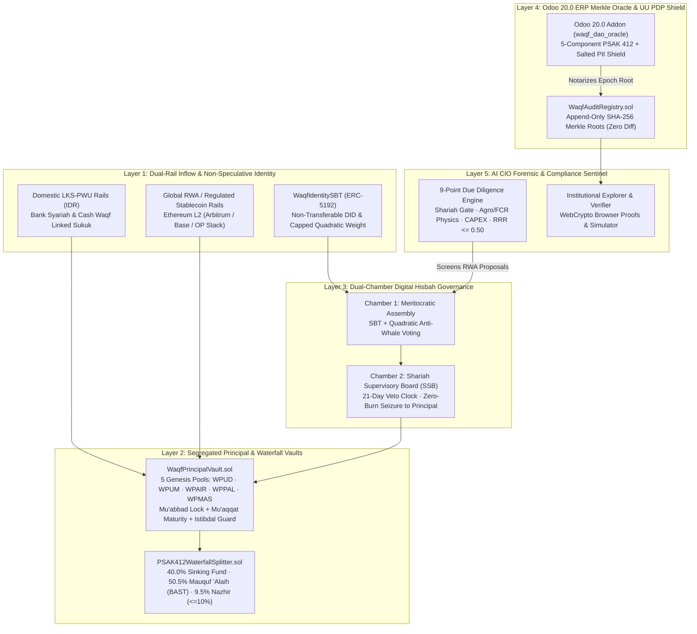

<div align="center">

# WAQF DAO

**Institutional On-Chain Endowment Protocol under AAOIFI Shari'ah Standard No. 60, PSAK 412, and Dual-Chamber Digital Hisbah Governance**

[](./LICENSE)
[](./packages/contracts/foundry.toml)
[](./packages/oracle-bridge/pyproject.toml)
[](./odoo-addons/waqf_dao_oracle/__manifest__.py)
[](./apps/explorer/package.json)
[](./docs/FIQH_OF_CODE.md)

[English Whitepaper](./docs/WHITEPAPER_EN.md) · [Whitepaper Bahasa Indonesia](./docs/WHITEPAPER_ID.md) · [Fiqh of Code Matrix](./docs/FIQH_OF_CODE.md) · [Dual-Nexus Legal Blueprint](./docs/LEGAL_DUAL_NEXUS_BLUEPRINT.md) · [Federated Nazhir Onboarding](./docs/FEDERATED_NAZHIR_ONBOARDING.md)

</div>

---

## Why WAQF DAO?

First-generation Islamic Web3 and waqf-blockchain initiatives struggled because **token experiments lacked statutory Nazhir grounding, audited accounting, and productive real-world cash flows**, while **legacy endowment institutions lacked cryptographic transparency and programmable capital protection**.

**WAQF DAO** bridges 1,400 years of *waqf* jurisprudence (*Tahbisul Ashli wa Tasbilul Manfa'ah* — preserving principal perpetually while streaming its usufruct to society) with an audited institutional operating stack:

- **Ownerless Smart Custody (`AAOIFI SS 60 Clause 2/4/2` & `PSAK 412 Par. 17`):** Isolates endowed principal from *Waqif*, *Nazhir*, and operating vendors, supporting both **Perpetual Waqf (*Mu'abbad*)** and time-locked **Temporary Cash Waqf (*Mu'aqqat*)**.
- **Statutory Waterfall Enforcement (`UU No. 41/2004`):** Hard-codes cash-basis *Nazhir* fees at `<= 10.00%` (`1000 bps`), upfront *Sinking Fund* capital restoration reserves (`10%–40%`), and `>= 50%` *Mauquf 'Alaih* beneficiary escrow gated by verified `BAST` attestations.
- **Anti-Plutocracy Dual-Chamber *Digital Hisbah*:** Pairs non-transferable **ERC-5192 Soulbound DIDs** with quadratic/capped voting (Chamber 1) and an asymmetric **Shariah Supervisory Board (`SSB`)** veto gate with a 21-day review clock and **Zero-Burn Anti-Spam Deposit Capture** (Chamber 2).
- **Odoo 20.0 ERP $\leftrightarrow$ L2 Merkle Audit Bridge:** Notarizes balanced 5-component PSAK 412 snapshots from [`npo-odoo-docker`](https://github.com/ridloabelian/npo-odoo-docker) using bit-for-bit identical domain-separated `SHA-256` Merkle trees (`0x00` leaf / `0x01` sorted-pair internal nodes) and **UU PDP (`Law No. 27/2022`)** salted PII commitments.
- **AI CIO 9-Point Forensic Sentinel:** Screens productive RWA proposals for biological impossibilities (e.g., Nile tilapia `FCR < 1.0`), thermal/agroclimate mismatch, `CAPEX` markups, accounting paradoxes, and asymmetric Risk-Reward Ratios (`RRR > 0.50`) before capital deployment.

---

## Five-Layer Protocol Architecture



---

## Institutional Genesis Anchor (Verified Real-World Baseline)

Initiated from the live operating ecosystem of **Yayasan Amal Produktif Indonesia (`STBPN BWI 3.3.00386`)**, **PT Produktif Indonesia Berdaya (`PT PIB`)**, **Forum Wakaf Produktif (`FWP`)**, and **Asosiasi Nazhir Indonesia (`ANI`)**, governed under the **WAQF Framework (*Wijhah · 'Azam · Qiyam · Fahs*)**:

- **Audit Track Record:** Four consecutive unqualified external **KAP** audit opinions (**`FY 2022–2025 WTP`**) under **PSAK 412**.
  - **FY 2024 (KAP WTP):** Total Assets `IDR 1,011,600,000` (`IDR 25,000,000` Temp. Liabilities + `IDR 986,600,000` Net Assets)
  - **FY 2025 (KAP WTP):** Total Assets `IDR 1,114,360,000` (`IDR 50,000,000` Temp. Liabilities + `IDR 1,064,360,000` Net Assets)
  - **FY 2026 (`Epoch 2026-11` Projection):** Total Assets `IDR 1,404,880,000` (`IDR 63,000,000` Temp. Liabilities + `IDR 1,341,880,000` Net Assets, `diff = 0`)
- **Five Genesis Endowment Pools (`Epoch 2026-11`):**
  - `WPUD` — Vannamei Aquaculture RWA (*Nautera*: `IDR 832.4M` structured via `IDR 532.4M` *Ijarah* + `IDR 300.0M` *Qardh Hasan*; **18.02% p.a.** cash yield; SROI `3.85x`)
  - `WPUM` — Multi-Sector Productive & Sovereign Sukuk (`CWLS`) Pool (SROI `5.04x`)
  - `WPAIR` — Clean Water Infrastructure (**41 active clusters**, **26,357 beneficiaries**, SROI **`1 : 4.11`**)
  - `WPPAL` — Humanitarian Perpetual Endowment (SROI `4.25x`)
  - `WPMAS` — Mosque, Madrasah & Qur'anic Education Endowment (SROI `3.90x`)

---

## Monorepo Structure & Verified Checks

| Package / Directory | Role & Stack | Verified Suite | Link |
| :--- | :--- | :--- | :--- |
| `packages/contracts/` | Solidity `0.8.24` (Foundry) core vaults, splitter, SBT, Shariah oracle, audit registry & Digital Hisbah governor | `29` Forge unit & fuzz tests (`4` suites, `0` failed) | [`packages/contracts`](./packages/contracts) |
| `packages/oracle-bridge/` | Pure Python `3.12` stdlib SHA-256 Merkle tree, UU PDP PII shield, PSAK 412 validator & `WaqfAuditRegistry` ABI relayer | `16` unittest cases (`0` failed) + `cast abi-encode` parity | [`packages/oracle-bridge`](./packages/oracle-bridge) |
| `packages/ai-cio-sentinel/` | 9-point AI CIO Forensic & Shariah Screening engine + deterministic Laya pool triage (`WPUD..WPMAS`) | `17` unittest cases (`0` failed) | [`packages/ai-cio-sentinel`](./packages/ai-cio-sentinel) |
| `odoo-addons/waqf_dao_oracle/` | Odoo `20.0` / `19.0` (`LGPL-3`) federated Nazhir module with scheduled PSAK 412 Merkle bundling | `python3 -m compileall` & Odoo/oracle Merkle parity | [`odoo-addons/waqf_dao_oracle`](./odoo-addons/waqf_dao_oracle) |
| `apps/explorer/` | React `19` + TypeScript + Vite institutional portal (`EN`/`ID`), Waterfall Simulator, Digital Hisbah & WebCrypto Verifier | `tsc --noEmit`, `4` Merkle tests, Vite `build` (`dist/`) | [`apps/explorer`](./apps/explorer) |
| `docs/` | Institutional Whitepapers (`EN` & `ID`), `Fiqh of Code` matrix, `RAK DAO / ADGM` Legal Blueprint & Nazhir Onboarding | Audited against live code & `audit_hygiene.py` | [`docs`](./docs) |

---

## Quickstart & Local Verification

### 1. Run the Complete Verification Suite
```bash
./scripts/test_all.sh
# or with GNU make installed:
make test
```

### 2. Smart Contracts (Foundry)
```bash
cd packages/contracts
forge test -vv
forge script script/DeployGenesisPools.s.sol
```

### 3. ERP Merkle Oracle Bridge CLI
```bash
cd packages/oracle-bridge
python3 -m unittest discover -s tests -v
python3 -m waqf_oracle.cli verify-fixture --fixture fixtures/genesis_epoch_2026_11.json
python3 -m waqf_oracle.cli notarize-preview
```

### 4. AI CIO Forensic & Shariah Sentinel CLI
```bash
cd packages/ai-cio-sentinel
python3 -m unittest discover -s tests -v

# Benchmark Passing Proposal (Nautera Ijarah+Qardh -> PASS)
python3 -m cio_sentinel.cli audit fixtures/nautera_vannamei_benchmark.json --format markdown

# Failing Proposal (Highland Biofloc -> REJECT_NO_GO with forensic flags)
python3 -m cio_sentinel.cli audit fixtures/external_highland_biofloc_proposal.json --format json

# Pool Mutation Triage
python3 -m cio_sentinel.cli triage "Wakaf Sumur Bor Air Bersih Pelosok"
```

### 5. Web3 Explorer & Digital Hisbah Portal
```bash
cd apps/explorer
npm install
npm run typecheck
npm run test:merkle
npm run build
npm run dev
```

---

## Documentation Suite

1. **[English Institutional Whitepaper (`docs/WHITEPAPER_EN.md`)](./docs/WHITEPAPER_EN.md)** — Full 5-layer protocol design, AAOIFI SS 60 jurisprudence mapping, mathematical invariants, and global roadmap.
2. **[Whitepaper Bahasa Indonesia (`docs/WHITEPAPER_ID.md`)](./docs/WHITEPAPER_ID.md)** — Arsitektur *Neo-Pasar Madinah*, integrasi *WAQF Framework*, kepatuhan **BWI / OJK POJK 23/2025 / DSN-MUI / UU PDP**, dan studi kasus *Nautera* & *WPAIR*.
3. **[Fiqh of Code Traceability Matrix (`docs/FIQH_OF_CODE.md`)](./docs/FIQH_OF_CODE.md)** — Clause-by-clause mapping from AAOIFI SS 60, GS 13, PSAK 412, and Law No. 41/2004 to Solidity functions, custom errors, and Python sentinel checks.
4. **[Dual-Nexus Legal Blueprint (`docs/LEGAL_DUAL_NEXUS_BLUEPRINT.md`)](./docs/LEGAL_DUAL_NEXUS_BLUEPRINT.md)** — Comparative structuring across **RAK DAO (DARe)**, **ADGM DLT Foundations**, and Indonesian **BWI Nazhir + LKS-PWU + PT Operating SPV** custody.
5. **[Federated Nazhir Onboarding (`docs/FEDERATED_NAZHIR_ONBOARDING.md`)](./docs/FEDERATED_NAZHIR_ONBOARDING.md)** — Step-by-step guide for FWP, ANI, and international endowments joining via `npo-odoo-docker` + `waqf_dao_oracle`.

---

## License & Citation

- **Protocol & Tools:** Licensed under the [Apache License 2.0](./LICENSE); Solidity smart contracts (`packages/contracts/src/`) carry `SPDX-License-Identifier: MIT`; Odoo addon (`odoo-addons/waqf_dao_oracle/`) is licensed under `LGPL-3`.
- **Citation:** See [`CITATION.cff`](./CITATION.cff).
