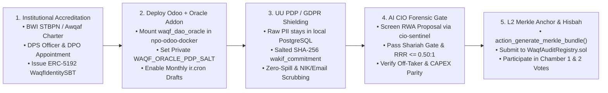

# Federated Nazhir Node Onboarding Guide (FWP, ANI & Global Awqaf Partners)

**Document Classification:** Technical & Institutional Onboarding Playbook  
**Version:** `1.0.0` (Genesis Epoch `2026-11`)  
**Target Institutions:** **Forum Wakaf Produktif (`FWP`)** · **Asosiasi Nazhir Indonesia (`ANI`)** · Registered BWI Nazhir Foundations · Malaysian & GCC Awqaf Boards · Mosque & University Endowments  
**Reference Stack:** `npo-odoo-docker` (`Odoo 20.0 / 19.0`) · `odoo-addons/waqf_dao_oracle` · `packages/oracle-bridge` · `packages/ai-cio-sentinel` · Base L2 (`WaqfAuditRegistry.sol`)

---

## 1. Onboarding Overview & Federation Architecture

Joining **WAQF DAO** as a federated Nazhir node allows an accredited endowment institution to keep **100% sovereign custody of its domestic legal titles (`AIW`/`SHW`), LKS-PWU bank accounts, and donor PII**, while publishing cryptographically verifiable **PSAK 412 / AAOIFI FAS 37** audit proofs and submitting real-sector projects through shared **AI CIO Forensic Screening** and **Dual-Chamber Digital Hisbah** verification.



### Supported Institutional Profiles

| Institution Type | Domestic Custody & Accounting Anchor | Protocol Role Badge (`WaqfIdentitySBT.sol`) |
| :--- | :--- | :--- |
| **Indonesian Nazhir (`FWP` / `ANI` Members)** | `STBPN BWI` license · **LKS-PWU** bank rails · **PSAK 412** (5 components) · **UU PDP (`Law 27/2022`)** | `RoleBadge.NAZHIR_CERTIFIED` |
| **Malaysian / GCC Awqaf Boards** | State Islamic Religious Council (`SIRC`) / Awqaf Ministry charter · **AAOIFI FAS 37 / SS 60** · Local data residency | `RoleBadge.NAZHIR_CERTIFIED` |
| **Mosque & University Trusts (`WPMAS` / Campus)** | Endowment deed / foundation charter · Segregated `Odoo` entity ledger | `RoleBadge.NAZHIR_CERTIFIED` / `RoleBadge.WAKIF` |
| **Accredited Shariah Scholars & Field Auditors** | Certified `DPS` (*Dewan Pengawas Syariah*) or **KJPP** / `BAST` auditor credentials | `RoleBadge.SHARIAH_BOARD` / `RoleBadge.IMPACT_VALIDATOR` |

---

## 2. Step 1 — Institutional Accreditation & Soulbound DID Issuance

Before touching production smart contracts, each prospective Nazhir completes four baseline verification checks with the federation guild (**ANI / FWP** verification committee & Chamber 2 SSB):

1. **Legal Custody Verification:** Valid Nazhir registration (e.g., `BWI STBPN` certificate in Indonesia or statutory Awqaf board charter abroad) plus non-commingled endowment bank custody (**LKS-PWU** or equivalent).
2. **External Accounting Readiness:** Commitment to publish **PSAK 412** 5-component statements (or AAOIFI FAS 37 mapping) without consolidating endowment principal into corporate operational balance sheets (**PSAK 412 par. 17**).
3. **Data Protection Officer (`DPO`) Designation:** Acceptance of strict **Zero-PII-On-Chain** rules under **UU No. 27/2022 (`UU PDP`)** and **GDPR**.
4. **On-Chain Soulbound Credentialing:** Once verified, an authorized `REGISTRAR_ROLE` issues the institution's non-transferable **ERC-5192** identity via `WaqfIdentitySBT.issueCredential(to, RoleBadge.NAZHIR_CERTIFIED, initialContributionUnits, metadataUri)`.
   - Remember: `WaqfIdentitySBT` enforces `SoulboundNonTransferable()` (`locked(tokenId) == true`), preventing governance credential trading, while capping quadratic voting weight at `MAX_VOTING_WEIGHT = 100` (`min(100, 1 + floor(sqrt(contributionUnits)))`).

---

## 3. Step 2 — Spin Up `npo-odoo-docker` with `waqf_dao_oracle`

Every federated Nazhir runs an isolated ERP node using **Odoo 20.0** (compatible with **Odoo 19.0**) inside `npo-odoo-docker`, mounting the open-source [`odoo-addons/waqf_dao_oracle`](file:///root/waqf-dao/odoo-addons/waqf_dao_oracle/__manifest__.py) module.

### 3.1 Verify Prerequisite Odoo Modules
Per [`odoo-addons/waqf_dao_oracle/__manifest__.py`](file:///root/waqf-dao/odoo-addons/waqf_dao_oracle/__manifest__.py), ensure your Odoo database includes:
- `base`
- `mail`
- `waqf_core`
- `l10n_id_waqf_psak112` *(providing the `waqf.pledge`, `waqf.asset`, and `waqf.distribution` models dynamically queried by `waqf.dao.notarization`)*

### 3.2 Configure `docker-compose.yml` and Secret UU PDP Salt
Mount `odoo-addons/waqf_dao_oracle` read-only into `/mnt/extra-addons/waqf_dao_oracle` and inject a **cryptographically random, institution-private** `WAQF_ORACLE_PDP_SALT` environment variable (never commit `.env` files or salts to version control):

```yaml
services:
  odoo:
    # Base npo-odoo-docker image (Odoo 20.0 / 19.0)
    volumes:
      - ./odoo-addons/waqf_dao_oracle:/mnt/extra-addons/waqf_dao_oracle:ro
    environment:
      - WAQF_ORACLE_PDP_SALT=${WAQF_ORACLE_PDP_SALT}
```

> [!IMPORTANT]
> **Production Salt Hygiene:** If `WAQF_ORACLE_PDP_SALT` is unset, both `privacy_shield.py` and `merkle_stdlib.py` fall back to `PUBLIC_FALLBACK_SALT` (`"waqf-dao-uupdp-public-domain-v1"`), which is strictly for public genesis fixtures and unit tests. Production Nazhir nodes **MUST** provision a unique 256-bit secret salt (`openssl rand -hex 32`) inside a vaulted `.env` file on the host.

Ensure `/mnt/extra-addons` is included in `addons_path` inside `odoo.conf`.

### 3.3 Install the Addon & Enable Automated Monthly Snapshots
Initialize `waqf_dao_oracle` inside your production database (e.g., `waqf_prod`):

```bash
docker compose exec odoo odoo \
  -d waqf_prod \
  --addons-path=/usr/lib/python3/dist-packages/odoo/addons,/mnt/extra-addons \
  -i waqf_dao_oracle \
  --stop-after-init
```

Restart the container (`docker compose restart odoo`). Once installed:
- Navigate to **WAQF DAO Oracle -> PSAK 412 Notarizations**.
- Monthly draft automation is pre-configured by [`ir_cron_data.xml`](file:///root/waqf-dao/odoo-addons/waqf_dao_oracle/data/ir_cron_data.xml) (`WAQF DAO: Prepare Monthly PSAK 412 Merkle Notarization Draft`), which runs `_cron_prepare_monthly_notarization()` every month.
- **Role Access Integrity ([`ir.model.access.csv`](file:///root/waqf-dao/odoo-addons/waqf_dao_oracle/security/ir.model.access.csv)):** Regular finance users (`base.group_user`) have read/write/create permissions (`perm_unlink = 0`) so notarized audit records cannot be silently deleted; only `base.group_system` holds unlink control for pre-publication draft maintenance.

---

## 4. Step 3 — Protect Donor Privacy under UU PDP (`Law No. 27/2022`) & GDPR

Public auditability must never compromise personal data protection. Both [`merkle_stdlib.py`](file:///root/waqf-dao/odoo-addons/waqf_dao_oracle/models/merkle_stdlib.py) (inside Odoo) and [`privacy_shield.py`](file:///root/waqf-dao/packages/oracle-bridge/waqf_oracle/privacy_shield.py) (inside the CLI bridge) enforce **zero raw PII leakage** through three deterministic layers:

1. **Key-Level PII Stripping (`RAW_PII_KEYS`):** Recursively deletes keys including `wakif_name`, `wakif_nik`, `wakif_phone`, `wakif_email`, `wakif_address`, `nik`, `phone`, `mobile`, `email`, `address`, `donor_name`, `donor_nik`, `donor_phone`, and `donor_email`.
2. **Regex Redaction (`scrub_text`):** Replaces any accidental inline 16-digit Indonesian `NIK` (`[REDACTED_NIK]`), phone numbers (`[REDACTED_PHONE]`), and emails (`[REDACTED_EMAIL]`), while throwing `ZeroSpillViolationError` / `ValueError` if forbidden entity isolation phrases or secret credential patterns (GitHub token prefixes, PEM private-key blocks, or API key prefixes) appear.
3. **Salted SHA-256 Commitments (`commit_wakif_identity`):** Converts donor identifiers locally inside Odoo using:
   $$\text{wakif\_commitment} = \texttt{"0x"} \parallel \text{SHA256}\Big(\texttt{"waqf:uupdp:v1:"} \parallel \text{WAQF\_ORACLE\_PDP\_SALT} \parallel \texttt{":"} \parallel \text{lowercase}(\text{trimmed\_id})\Big)$$
   - A *Wakif* can verify their own pledge inclusion proof using their receipt reference without ever exposing their identity to third parties or foreign nodes.
   - **GDPR / UU PDP Right to Erasure:** Because raw PII lives exclusively inside the local PostgreSQL database, honoring a donor's data-erasure request removes or anonymizes their off-chain CRM record cleanly without breaking historical on-chain Merkle commitments.

---

## 5. Step 4 — Publishing & Verifying PSAK 412 Merkle Epochs

### 5.1 Pre-Notarization Accounting Validation
Inside **WAQF DAO Oracle -> PSAK 412 Notarizations**, Odoo's `@api.constrains` (`_check_psak412_and_zero_spill`) blocks any malformed snapshot before hashing:

- **PSAK 412 Balance Identity:** `total_assets_idr == temp_waqf_liabilities_idr + net_assets_idr` (temporary cash waqf *Mu'aqqat* recorded strictly as liabilities per PSAK 412 par. 23).
- **Zero Reconciliation Diff:** `reconciliation_diff_idr == 0`.
- **Law No. 41/2004 Nazhir Fee Cap:** `0.0 <= nazhir_cash_fee_ratio <= 0.10` (`<= 10.00%`).
- **Mauquf 'Alaih Beneficiary Floor:** `0.50 <= mauquf_alaih_ratio <= 1.0` (`>= 50.00%`).
- **Pool Sum Parity:** `WPUD + WPUM + WPAIR + WPPAL + WPMAS == total_assets_idr`.

### 5.2 Four-Click Notarization Workflow
1. Click **Generate Merkle Bundle** (`action_generate_merkle_bundle`): Collects canonical `waqf.psak412_summary`, `waqf.pledge` (AIW/APAIW), `waqf.asset` (BPN/equipment), and `waqf.distribution` (BAST) leaves, computes `merkle_root`, per-leaf `proof_bundle_json`, and `abi_payload_json`, moving status from `draft` → `bundled`.
2. Submit the notarization transaction to your target EVM Layer-2 (**Base Sepolia `chain_id 84532`** during Phase I/II shadow testing, or **Base Mainnet `8453`** in production) using an address granted `NOTARIZER_ROLE` on `WaqfAuditRegistry.sol`:
   ```solidity
   notarizeEpoch(
       string periodCode,
       bytes32 merkleRoot,
       uint256 totalAssetsIdr,
       uint256 tempWaqfLiabilitiesIdr,
       uint256 netAssetsIdr,
       uint256 sroiRatioBps,
       bytes32 odooDbHash
   )
   ```
   *(Verified ABI parity: both `packages/oracle-bridge/waqf_oracle/relayer.py` and `odoo-addons/waqf_dao_oracle/models/waqf_dao_notarization.py` emit this exact 7-argument signature.)*
3. Paste the confirmed `0x...` 64-hex transaction hash into `l2_tx_hash` and click **Mark On-Chain Notarized** (`action_mark_notarized`).
4. Click **Verify Merkle Bundle** (`action_verify_bundle`) to cross-verify every leaf inclusion proof against `merkle_root`, transitioning state to `verified`.

### 5.3 Standalone Verification via `packages/oracle-bridge` CLI
Auditors and peer Nazhir reviewers can also verify exported epoch fixtures offline from the terminal:

```bash
export PYTHONPATH=/root/waqf-dao/packages/oracle-bridge
python3 -m waqf_oracle.cli verify-fixture \
  --fixture packages/oracle-bridge/fixtures/genesis_epoch_2026_11.json
```

Expected verification checks: PSAK 412 balance identity (`diff == 0`), Nazhir ratio `<= 0.10`, Mauquf 'Alaih ratio `>= 0.50`, exact `merkle_root` recomputation (`0x8847ae1a98d62b44dbbfe44900cce0620b7e13914d9bd509d3d694f8fb3921cc` for Genesis Epoch `2026-11`), and inclusion verification across all `10` leaves.

---

## 6. Step 5 — Passing AI CIO Forensic Screening Before Capital Deployment

Before any federated Nazhir submits an investment or productive RWA proposal to **Chamber 1 (`DigitalHisbahGovernor.propose`)**, the proposal JSON **must pass** the **9-point AI CIO Forensic & Shariah Sentinel** (`packages/ai-cio-sentinel`).

### 6.1 Running the Forensic CLI Locally

```bash
export PYTHONPATH=/root/waqf-dao/packages/ai-cio-sentinel

# Benchmark passing reference (Nautera Vannamei RWA) -> PASS (Risk Score 0.0 / Benchmark 14/100)
python3 -m cio_sentinel.cli audit \
  packages/ai-cio-sentinel/fixtures/nautera_vannamei_benchmark.json

# Known failing proposal (Highland Biofloc) -> REJECT_NO_GO
python3 -m cio_sentinel.cli audit \
  packages/ai-cio-sentinel/fixtures/external_highland_biofloc_proposal.json
```

You can also validate incoming bank transfer remarks against deterministic **Laya System-1** pool routing (`WPUD`, `WPUM`, `WPAIR`, `WPPAL`, `WPMAS`) and `Zero-Spill` rules:

```bash
python3 -m cio_sentinel.cli triage "Wakaf sumur bor air bersih WPAIR klaster 42" --format markdown
```

### 6.2 Mandatory Pass Checklist for Federated Nazhir Proposals

| Screening Gate | Mandatory Requirement to Achieve `PASS` | Common Causes of `REJECT_NO_GO` |
| :--- | :--- | :--- |
| **Shariah Contract (`shariah_gate.py`)** | Use principal-protected structures (`ijarah_qardh_hybrid`, `cwls_sukuk`, `back_to_back_po_murabahah`) with `has_principal_guarantee: true` and `asset_reverts_to_operator_at_end: false`. | Proposing unprotected `mudharabah` / `musyarakah` on core principal or reverting equipment to the vendor at contract maturity. |
| **Statutory Waterfall** | `sinking_fund_pct >= 10.0`, `mauquf_alaih_pct >= 50.0`, `nazhir_total_pct <= 10.0`, `double_nazhir_stacking: false`. | Stacking external intermediary fees on top of internal Nazhir fees (`> 10%`), violating UU No. 41/2004 Pasal 12. |
| **Land & Off-Taker** | Both `has_aiw_certificate` and `has_bpn_stw` `true` — OR verified `offtaker_entity_verified: true` + `has_principal_guarantee: true` + `tenure_years >= 5.0`. | Deploying upfront physical CAPEX onto uncertified land or short leases without commercial collateral. |
| **Biological & Engineering Physics** | Aquaculture `true_fcr >= 1.15` (`<= 1.80`), circular tank density `<= 50.0 kg/m³` (with `0.20 m` freeboard), thermal feasibility (`<= 3.0` unheated highland cycles). | Claiming physically impossible `FCR < 1.0`, overstocked pond biomass, or excessive unheated cycles at `> 700 mdpl`. |
| **CAPEX & Financial Integrity** | `capex_per_unit_idr` markup `<= +25.0%` vs engineering benchmark; `claimed_net_profit_idr <= claimed_gross_revenue_idr`; `RRR <= 0.50:1`. | Inflated RAB/BOM markups (`>= +50%`), impossible track-record profit exceeding gross revenue, or asymmetric `RRR >= 2.0:1`. |
| **Opportunity Cost Floor** | `realistic_net_yield_pct >= 6.0%` (Sovereign CWLS risk-free floor) and competitive with internal protected benchmarks (`18.02%` for aquaculture). | Taking higher operational risk for yields below sovereign CWLS sukuk. |

---

## 7. Step 6 — Going Live in Dual-Chamber Digital Hisbah Governance

Once accredited with a **WaqfIdentitySBT**, running a verified `waqf_dao_oracle` node, and holding an AI CIO **`PASS`** report:

1. **Whitelisting Yield Adapter & KJPP Appraisal:** Have an accredited `APPRAISER_ROLE` submit asset valuation via `ShariahOracle.submitAppraisal(...)` (`expiresAt > block.timestamp`, non-zero `reportHash`), then have `SSB_ROLE` approve both the appraisal (`approveAppraisal`) and underlying contract adapter (`setAdapterApproval` with `fatwaHash`).
2. **Proposing on Chamber 1 (`DigitalHisbahGovernor.propose`):** Stake the refundable good-faith governance deposit (`proposalDeposit`) and submit the target pool (`WPUD`, `WPUM`, `WPAIR`, `WPPAL`, or `WPMAS`) and calldata.
3. **Community Quadratic Vote + 21-Day SSB Window:** Accredited `WaqfIdentitySBT` holders cast quadratic-capped votes (`castVote`), followed by the mandatory `21 days` (`SSB_REVIEW_PERIOD`) Chamber 2 Shariah review (`approveBySSB` or `vetoBySSB`).
4. **Execution & BAST-Gated Impact Release:** After `executeProposal`, realized operational cash returns route through `WaqfPrincipalVault.routeRealizedYield` → `PSAK412WaterfallSplitter.distributeYield`, and beneficiary tranches unlock solely upon verified physical `bastAttestationHash` (`releaseMauqufAlaih`).
