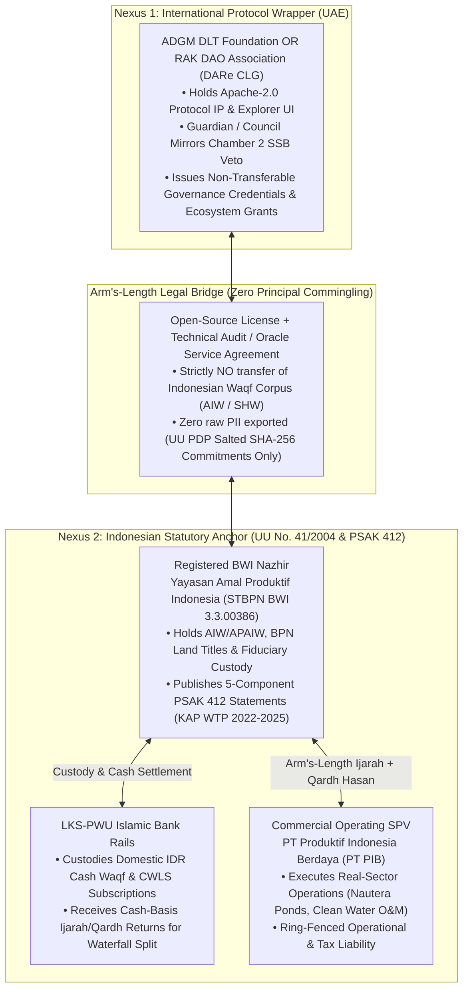

# WAQF DAO Legal Dual-Nexus Blueprint: Pairing UAE DLT Wrappers (RAK DAO / ADGM) with Indonesian Statutory Waqf Anchors

**Document Classification:** Institutional Legal & Regulatory Playbook  
**Version:** `1.0.0` (Genesis Epoch `2026-11`)  
**Effective Legal Anchors:** Yayasan Amal Produktif Indonesia (`STBPN BWI 3.3.00386`) · PT Produktif Indonesia Berdaya (`PT PIB`)  
**Jurisdictional Scope:** United Arab Emirates (**RAK DAO DARe** / **ADGM DLT Foundations**) ↔ Republic of Indonesia (**BWI · LKS-PWU · OJK · DSN-MUI · UU PDP**)

> *Disclaimer: This blueprint provides institutional protocol architecture and statutory compliance structuring grounded in enacted regulations as of November 2026. It is intended for institutional Nazhir boards, Shariah supervisory councils, and licensed legal counsel executing jurisdictional filings.*

---

## 1. The Legal Dilemma: Why Single-Jurisdiction or Unwrapped Waqf DAOs Fail

Building a global blockchain-enabled endowment protocol fails if either side of the legal bridge is broken:

1. **The Unwrapped DAO Trap (Unlimited Personal Liability & Invalid Custody):**
   An unincorporated DAO lacking a legal wrapper is routinely treated by courts as an **unincorporated general partnership**. Under Indonesian civil law (*Persekutuan Perdata*) and common-law jurisdictions alike, contributors, multisig signers, Shariah scholars, and *Nazhir* directors face **joint and several unlimited personal liability** for protocol errors, vendor disputes, or regulatory fines. Worse, an unwrapped smart contract **cannot hold an Indonesian *Akta Ikrar Wakaf (`AIW`)*, own BPN *Sertifikat Tanah Wakaf*, open an `LKS-PWU` Islamic bank account, or enforce an *Ijarah* lease in court**.
2. **The Offshore-Only Trap (Finterra Precedent):**
   Attempting to place domestic physical real estate or Indonesian *wakaf uang* directly under a foreign blockchain SPV collides with territorial endowment statutes (**UU No. 41 Tahun 2004** in Indonesia; State Islamic Religious Enactments in Malaysia; Awqaf ministries in GCC), triggering high legal overhead, bank de-risking, and non-recognition by **Badan Wakaf Indonesia (`BWI`)**.
3. **The Domestic-Only Web2 Trap (Zero Cross-Border Protocol Interoperability):**
   Restricting everything inside a single domestic foundation leaves open-source protocol IP, international contributor grants, and cross-border *Umma* federation nodes without a neutral international governance domicile.

**The Solution — Dual-Nexus Legal Wrapper:** Separate **International Protocol Governance & Open-Source Coordination** (domiciled in a purpose-built UAE DLT/DAO entity) from **Domestic Endowed Corpus Custody & Real-Sector Execution** (anchored inside a registered Indonesian **BWI Nazhir + LKS-PWU Bank Rails + Operating PT SPV**).

---

## 2. Comparative Wrapper Analysis: Unwrapped DAO vs. RAK DAO (`DARe`) vs. ADGM DLT Foundation

Evaluating the three international structuring paths against **AAOIFI Governance Standard No. 13**, **AAOIFI SS 60 Clause `2/4/2`**, and institutional audit expectations yields the following exact comparison:

| Dimension | Option A: Unwrapped DAO *(Rejected)* | Option B: RAK DAO Association (`DARe CLG`) | Option C: ADGM DLT Foundation *(Target Phase III+)* |
| :--- | :--- | :--- | :--- |
| **Jurisdiction** | None (stateless multisig) | Ras Al Khaimah Digital Assets Oasis (UAE Free Zone) | Abu Dhabi Global Market (UAE International Financial Centre) |
| **Legal Vehicle** | None (deemed General Partnership) | **Company Limited by Guarantee (`CLG`)** — non-profit member structure without distributable shares | **DLT Foundation** under *ADGM DLT Foundations Regulations 2023* — autonomous ownerless legal personality |
| **Shariah Alignment (`2/4/2`)** | Fails — personal exposure of signers | Good — non-profit CLG removes equity dividend extraction | **Optimal** — Foundation has *zero shareholders*, directly mirroring ***Dhimmah Maliyyah Mustaqillah*** |
| **Governance Organs** | Informal multisig signers | Founding / Council members + DARe membership tiers; member guarantee caps liability | **Foundation Council (`>= 2` Councillors)** + **Guardian** *(maps 1:1 to Chamber 2 SSB / DPS Veto)* + Token/DID Assembly |
| **Published Statutory / License Tiers & Fees (USD)** | `$0` *(catastrophic legal risk)* | **Startup DAO** (`< 100` members, `< $1M` treasury, no public token sale): **`USD 4,500`** incorporation/annual renewal **Alpha DAO** (`> 100` members or `> $1M` treasury): **`USD 9,500`** incorporation/annual renewal | Statutory Registration Authority fees: Name Reservation **`USD 200`** + Application **`USD 500`** + Commercial Licence **`USD 8,000`/yr** + Data Protection **`USD 300`/yr** *(plus CSP & ADGM-registered audit overhead)* |
| **Initial Asset / Guarantee Requirement** | None | Financial guarantee pledge by founding members (fiat or smart-contract-escrowed crypto) | Minimum initial asset value (commonly `USD 25,000–50,000`) paid in **fiat or FSRA-recognized stablecoins** within 6 months (no arbitrary tokens) |
| **AML / UBO & Audit Compliance** | None — blocked by institutional banks | UAE Federal AML/CFT, UBO registration for council/signers, DARe governance reporting | Full FSRA/RA AML/UBO KYC on Council, Founders & Guardian + **mandatory annual audited financial statements** via an **ADGM-registered auditor** |
| **Bank & Institutional Pedigree** | Unbankable | Strong for Web3-native protocol associations, early federation grants & builder ops | **Tier-1 Sovereign & GCC Awqaf Bankability** (preferred by regional Islamic banks, sovereign funds & ministries) |
| **Recommended WAQF DAO Phase** | **Prohibited** | **Phase II Fast-Track Wrapper** (`Startup DAO` for rapid multi-Nazhir FWP/ANI protocol association launch) | **Phase III–IV Institutional Scaling** (once cross-border federated treasury exceeds `USD 1M+` or institutional *sil'ah* rails launch) |

### Strategic Structuring Decision
- **Phase II Entry (`RAK DAO DARe Startup CLG`):** Minimizes initial burn (`USD 4,500` statutory baseline) while immediately granting limited-liability legal personality, member guarantee shielding, and contractual capacity to coordinate **FWP** and **ANI** open-source protocol development.
- **Phase III–IV Institutional Upgrade (`ADGM DLT Foundation`):** Transitions protocol governance into an ownerless **DLT Foundation** where the **ADGM Guardian** legally mirrors the on-chain **Chamber 2 Shariah Supervisory Board (`DPS`)** inside `ShariahOracle.sol` and **ADGM-registered annual audits** harmonize with Indonesia's **KAP WTP** external audit streak.

---

## 3. Indonesian Domestic Statutory Anchor (`UU 41/2004`, `LKS-PWU`, `PT SPV`)

No matter how sophisticated the UAE protocol wrapper is, **100% of Indonesian *waqf* assets stay domestically anchored** inside three statutory pillars established in production by **Yayasan Amal Produktif Indonesia (`STBPN BWI 3.3.00386`)**:

### Pillar 1: Registered BWI Nazhir (`Yayasan Amal Produktif Indonesia — STBPN BWI 3.3.00386`)
- **Statutory Authority:** Licensed under **UU No. 41 Tahun 2004 tentang Wakaf** and **PP No. 42 Tahun 2006**, carrying official Nazhir registration (`STBPN BWI 3.3.00386`).
- **Sole Fiduciary Title Holder:** Holds all *Akta Ikrar Wakaf* (`AIW`), *Akta Pengganti AIW* (`APAIW`), and BPN *Sertifikat Hak Wakaf* (`SHW`) deeds. No UAE entity or smart contract ever replaces BPN or BWI on legal land titles.
- **PSAK 412 Reporting Entity (`Paragraf 17`):** Maintains a completely segregated **Entitas Wakaf** chart of accounts inside **Odoo 20.0 ERP** (`npo-odoo-docker`), audited annually by an independent Public Accounting Firm (**`KAP WTP` streak `FY 2022–2025`**), never commingled with Yayasan operational grants or private funds.
- **Criminal Fee Cap Compliance (`Pasal 12 & Pasal 67 ayat 3`):** Statutory Nazhir remuneration (`ujrah`) is strictly bounded at **`<= 10%` of realized net cash returns** (`PSAK 412 par. 36`). Taking `> 10%` triggers criminal exposure up to **3 years imprisonment and/or IDR 300 million fine** under **Pasal 67 ayat (3)**—a risk eliminated mechanically by `PSAK412WaterfallSplitter.sol` reverting any split exceeding `1,000 bps`.

### Pillar 2: LKS-PWU Islamic Banking Custody Rails
- Under **UU No. 41/2004 Pasal 28–31**, monetary endowments (*Wakaf Uang*) **must** be deposited through a Ministry of Religious Affairs / BWI-appointed **Lembaga Keuangan Syariah Penerima Wakaf Uang (`LKS-PWU`)**.
- **Cash Custody Separation:** IDR inflows enter the dedicated **LKS-PWU** escrow account; the bank issues the statutory *Sertifikat Wakaf Uang (`SWU`)*; and **Odoo 20.0 (`waqf_dao_oracle`)** mints a purely informational cryptographic audit leaf (containing zero raw PII) into the monthly Merkle root.
- **Sovereign CWLS Integration:** Liquid reserve allocations (such as Pool `WPUM`) subscribe directly to Ministry of Finance / Bank Indonesia **Cash Waqf Linked Sukuk (`CWLS` / `SWR` Series)** through LKS-PWU sub-registry custody, establishing the `6.00%–6.75%` sovereign risk-free baseline used by `ai-cio-sentinel`.

### Pillar 3: Ring-Fenced Operating SPV (`PT Produktif Indonesia Berdaya / PT PIB`)
- Why a commercial PT rather than running coastal shrimp ponds or rural water engineering directly inside a Yayasan?
  1. **Tax & Licensing Hygiene:** Commercial operating permits, coastal aquaculture environmental approvals, B2B cold-chain sales invoices (`PPN`/`PPh`), and manpower contracts belong inside a Limited Liability Company (`Perseroan Terbatas`).
  2. **Liability Firewall:** If an operational equipment failure or commercial vendor dispute occurs at `PT PIB`, creditors **cannot seize or attach *waqf* principal (`Mawquf Bih`)** owned by **Yayasan Amal Produktif Indonesia**.
  3. **Principal-Protected Contracting (*Ijarah + Qardh Hasan*):** As proven in the **Nautera (`IDR 832.4 million`)** structure:
     - `Yayasan API` acquires and retains title to physical infrastructure (`IDR 532.4M` HDPE ponds, paddlewheels, generators) and leases them to `PT PIB` via an **Ijarah** agreement.
     - `Yayasan API` provides **`IDR 300.0M` Qardh Hasan** working capital backed by signed B2B cold-storage off-takers and multi-year lease collateral.
     - At contract end, productive fixed assets **remain 100% owned by the *waqf* entity**, neutralizing the "operator asset reversion" capital trap detected by `shariah_gate.py`.

---

## 4. OJK & DSN-MUI Regulatory Compliance Boundaries

Operating at the intersection of Islamic endowments and distributed ledgers in Indonesia requires surgical clarity across **OJK**, **DSN-MUI**, **BWI**, and **Komdigi (`UU PDP`)** regulations:

| Regulatory Regime | What It Governs | WAQF DAO Compliance Boundary | Engineering Enforcement |
| :--- | :--- | :--- | :--- |
| **OJK POJK No. 27/2024 jo. POJK No. 23/2025** *(Digital Financial Assets / AKD & Crypto Derivatives)* | Regulates crypto-asset trading venues, digital financial assets (`AKD`), and explicitly requires OJK Exchange approval for **crypto derivatives** (enacted Oct/Nov 2025). | **Non-Speculative / Non-Derivative Architecture:** WAQF DAO issues **zero tradable governance coins**, **zero floating-yield derivatives**, and **zero margin/leverage products**. Governance badges (`WaqfIdentitySBT`) are strictly non-transferable (`ERC-5192`). Public crypto fundraising/exchange listing is strictly excluded unless routed through an OJK-licensed AKD Exchange. | `WaqfIdentitySBT.sol` locks all transfers (`locked() == true`); treasury vaults hold fiat/1:1 reserved settlement assets rather than speculative tokens. |
| **OJK POJK No. 57/POJK.04/2020** *(Securities Crowdfunding / SCF, as amended)* | Regulates public issuance of equity, debt, and **Sukuk** via IT-based crowdfunding platforms. | **Clean Boundary Between Waqf & Retail Sukuk:** Pure *waqf* (perpetual *Mu'abbad* or cash *waqf* *Mu'aqqat* under UU 41/2004) flows via **BWI Nazhir + LKS-PWU**. Whenever an operating SPV like `PT PIB` raises **commercial *Musyarakah/Ijarah Sukuk*** from retail investors alongside *waqf* co-investment, that commercial tranche is issued strictly through an **OJK-licensed Syariah SCF Penyelenggara**, never via unregulated DAO token sales. | Separate on-chain pool tagging (`WPUD`, `WPUM`) and off-chain SPV tranche ledgers in Odoo 20.0. |
| **DSN-MUI RWA / *Sil'ah* Framework** *(incl. Nov 18, 2026 FGD on Tokenized RWA & Sil'ah)* | Classifies compliant digital representations of real-world assets as ***sil'ah*** (tangible/identifiable economic goods with real utility, valid ownership, zero *gharar* and *maysir*). | **100% *Sil'ah*-Anchored Asset Proofs:** Every productive asset representation in WAQF DAO maps 1-to-1 to physically verifiable assets (`BPN SHW`, `Ijarah` pond equipment schedules, `CWLS` registry certificates) appraised by an independent **KJPP** (`>= 102%` *Istibdal* parity). Zero unbacked algorithmic tokens. | `WaqfAssetLeaf` binds `certificate_ref`, `book_value_idr`, and `PSAK_412_FAIR_VALUE` to immutable Merkle proofs; `ai-cio-sentinel` bans pure unhedged speculative contracts. |
| **UU No. 27 Tahun 2022 (`UU PDP`) & GDPR** | Governs personal data collection, pseudonimisation, purpose limitation, cross-border data transfer, and Right to Erasure. | **Zero-PII-On-Chain & Zero Cross-Border PII Export:** Raw donor names, 16-digit Indonesian `NIK`s, phone numbers, and emails remain strictly inside the domestic `npo-odoo-docker` PostgreSQL volume in Indonesia. Neither the UAE wrapper nor Ethereum L2 ever receives raw PII. | `privacy_shield.py` strips `RAW_PII_KEYS`, redacts regex PII, and emits only irreversible salted SHA-256 `wakif_commitment` digests; salt rotation or record deletion off-chain respects erasure requests without mutating past Merkle roots. |

---

## 5. Mandatory Charter Clauses for Dual-Nexus Incorporation

Legal counsel drafting the **ADGM DLT Foundation Charter & By-Laws** or **RAK DAO DARe Constitution** alongside the **Indonesian Nazhir Cooperative Agreement** MUST embed five non-negotiable clauses:

1. **Clause of Autonomous Patrimony (*Dhimmah Maliyyah Mustaqillah*):** Expressly confirms that no Founder, Councillor, Guardian, Developer, or Member holds proprietary equity or residual distribution rights in any protocol pool, satisfying **AAOIFI SS 60 Clause `2/4/2`** and **ADGM/RAK non-profit asset locks**.
2. **Guardian / Shariah Supervisory Board Reserve Powers (`AAOIFI GS 13`):** Grants the accredited **DPS / Guardian** organ unilateral authority to veto any protocol parameter upgrade, asset *Istibdal*, or pool deployment violating *Shariah* principles, mirrored cryptographically by `ShariahOracle.sol`.
3. **Statutory Compliance Supremacy Clause:** Expressly states that for any Indonesian endowment pool, **UU No. 41/2004**, **PSAK 412**, **LKS-PWU banking mandates**, and **UU PDP** supersede any general DAO governance vote (`Chamber 1` cannot vote to raise Nazhir fees above `10%`).
4. **Zero-Burn Penalty Redirection:** Provides that forfeited governance proposal deposits from rejected or malicious proposals constitute charitable accretion to the *Mu'abbad* perpetual endowment pool rather than token burning or private profit.
5. **Dual-Audit Synchronization:** Requires synchronization of the annual UAE Foundation statutory audit with the Indonesian **KAP (`PSAK 412`)** audit cycle, notarized deterministically into `WaqfAuditRegistry.sol`.
