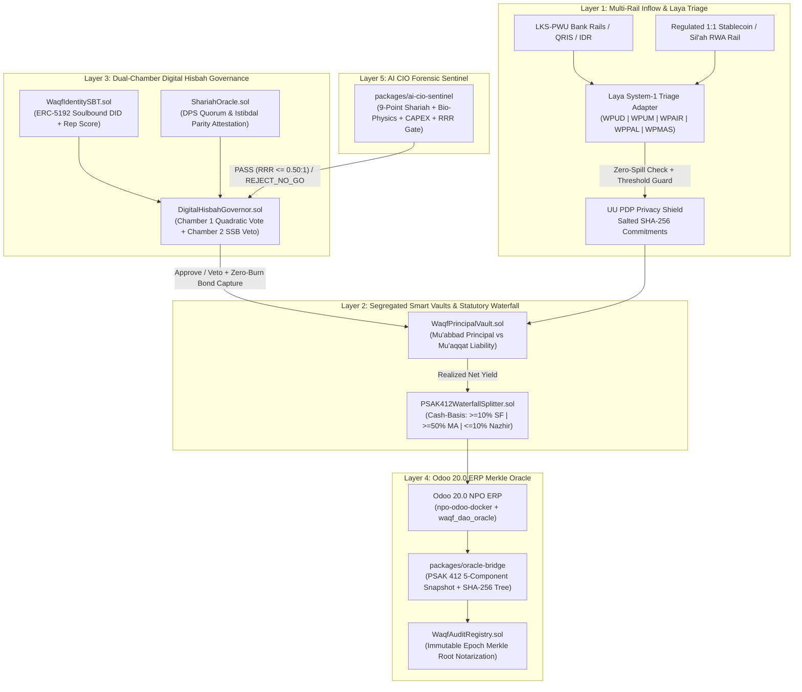
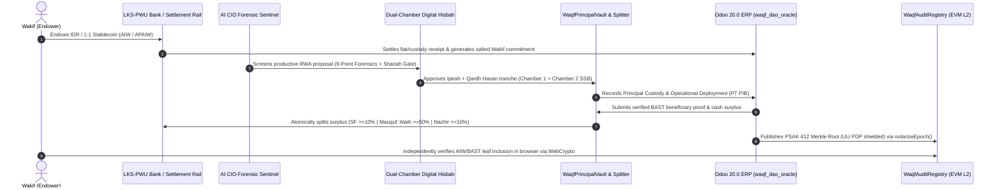
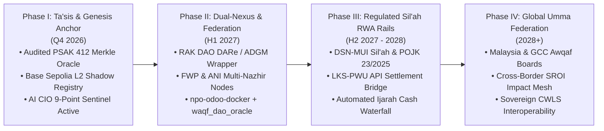

# WAQF DAO: An Ownerless, Asset-Backed Protocol for Global Islamic Endowments under AAOIFI SS 60, PSAK 412, and Digital Hisbah Governance

**Document Classification:** Institutional Protocol Whitepaper (`EN`)  
**Version:** `1.0.0` (Genesis Epoch `2026-11`)  
**Publication Date:** November 18, 2026  
**Institutional Anchors:** Yayasan Amal Produktif Indonesia (`STBPN BWI 3.3.00386`) · PT Produktif Indonesia Berdaya (`PT PIB`) · Forum Wakaf Produktif (`FWP`) · Asosiasi Nazhir Indonesia (`ANI`)  
**Governance & Impact Methodology:** WAQF Framework (*Wijhah · 'Azam · Qiyam · Fahs*)  
**Protocol Standards:** AAOIFI Shari'ah Standard No. 60 (*Waqf*) · AAOIFI Governance Standard No. 13 (*Waqf Governance*) · PSAK 412 (ex-PSAK 112) · Law No. 41/2004 on Waqf · Law No. 27/2022 (UU PDP)

---

## Executive Summary

Global Islamic endowments (*waqf*) represent one of history's longest-surviving institutional mechanisms for financing public goods, water infrastructure, education, healthcare, and productive commerce without relying on sovereign debt or recurring taxation. Yet contemporary institutional *waqf* faces a structural paradox: **analog endowments suffer from low transparency, fragmented bookkeeping, and illiquid asset registries, while first-generation Web3 "Islamic DeFi" initiatives suffer from token emission volatility, unbacked speculation, regulatory disconnection, and the complete absence of audited statutory accounting.**

**WAQF DAO** resolves this paradox by uniting **1,400-year Islamic endowment jurisprudence** (*Tahbisul Ashli wa Tasbilul Manfa'ah* — preserving the principal forever while liberating the usufruct for society) with a **five-layer deterministic protocol stack** anchored to live, externally audited real-world operations:

1. **Audited Real-World Genesis Anchor:** Initiated from the production stack of **Yayasan Amal Produktif Indonesia (`STBPN BWI 3.3.00386`)** and its commercial operating SPV **PT Produktif Indonesia Berdaya (`PT PIB`)**, carrying **four consecutive unqualified external KAP audit opinions (`FY 2022–2025 WTP`)** under **PSAK 412** (*Akuntansi Wakaf*, previously PSAK 112) with audited asset growth from **IDR 1,011.60 million (`FY 2024`)** to **IDR 1,114.36 million (`FY 2025`)** and **IDR 1,404.88 million (`FY 2026` Genesis Epoch projection, `reconciliation_diff_idr == 0`)**.
2. **Productive Benchmark Evidence:** Live deployment across five endowment pools (`WPUD`, `WPUM`, `WPAIR`, `WPPAL`, `WPMAS`) including the **Nautera Vannamei Aquaculture RWA** (`IDR 832.4 million` total structured deployment via `IDR 532.4 million` *Ijarah* asset custody + `IDR 300.0 million` *Qardh Hasan* working capital, generating **18.02% p.a.** net cash yield to foundation at a **0.42:1 Risk-Reward Ratio**) and **WPAIR Clean Water Infrastructure** (**SROI `1 : 4.11`** across **41 active clusters** serving **26,357 beneficiaries**).
3. **Ownerless Smart Treasury (*Dhimmah Maliyyah Mustaqillah*):** Smart contracts implementing **AAOIFI Shari'ah Standard No. 60 Clause `2/4/2`** so that endowed principal resides in an autonomous, non-extractable legal and cryptographic boundary separated from the *Waqif* (endower), the *Nazhir* (trustee), and operating vendors.
4. **Dual-Chamber Digital Hisbah Governance:** Non-transferable Soulbound DIDs (**ERC-5192**) paired with quadratic reputation-weighted community voting (Chamber 1) and an on-chain **Shariah Supervisory Board (`DPS`)** holding an asymmetric Shariah veto (Chamber 2) under **AAOIFI Governance Standard No. 13**, eliminating plutocratic governance capture.
5. **ERP Merkle Oracle & AI CIO Forensic Sentinel:** Automated cryptographic notarization of 5-component PSAK 412 trial balances from **Odoo 20.0 ERP** (`npo-odoo-docker` + `waqf_dao_oracle`) protected by a **UU PDP (`Law No. 27/2022`) salted SHA-256 privacy shield**, gated upstream by a **9-point AI CIO Forensic Sentinel** that mathematically blocks biological impossibilities, CAPEX markups, and capital traps before a single rupiah or stablecoin leaves the vault.

---

## 1. The 1,400-Year Neo-Pasar Madinah Continuum

Contemporary blockchain protocols often treat governance as a purely software engineering exercise invented in 2009. In contrast, WAQF DAO grounds its protocol topology in the original constitutional architecture established in seventh-century Madinah—what we term the **Neo-Pasar Madinah Thesis**.

When the Prophet Muhammad ﷺ established the civic economy of Madinah, the institutional transformation proceeded through an explicit sequence of public infrastructure, commercial commons, and continuous oversight:

1. **Sacred Civic Foundation (*Masjid Quba & Masjid Nabawi*):** Established the non-partisan spiritual, educational, and communal sanctuary whose core assets belonged to the *Ummah* rather than private dynasties.
2. **Productive Commercial Commons (*Pasar Manakhah*):** Faced with monopolistic market control and extractive land-rent gatekeeping in existing bazaars, the Prophet ﷺ designated an open commercial ground (*Suq al-Manakhah*) endowed as public productive space so small merchants could trade directly without predatory rent extraction.
3. ***La Kharaja* (Rent-Shielded Capital Preservation) & *Al-Hisbah* (Independent Market Oversight):** Two constitutional rules prevented *Pasar Manakhah* from decaying into private feudalism:
   - ***La Kharaja*:** Traders could not be subjected to arbitrary feudal rents or capital confiscation (*kharaj*) that eroded productive working capital—mirrored in WAQF DAO's rejection of predatory fee stacking, *Mudharabah* principal-loss exposure on core *waqf*, and operator asset reversion.
   - ***Al-Hisbah*:** Independent market inspectors (*Muhtasib*) continuously audited weights, measures, contract fairness, and pricing transparency—mirrored in WAQF DAO's Dual-Chamber Digital Hisbah, Odoo 20.0 Merkle Audit Oracle, and 9-point AI CIO Forensic Sentinel.

### Mapping Classical Precedent to the WAQF Framework

WAQF DAO operationalizes the **Neo-Pasar Madinah** continuum through the institutional **WAQF Framework (`Wijhah · 'Azam · Qiyam · Fahs`)**:

| WAQF Stage | Classical Madinah Anchor | Modern Institutional Practice | WAQF DAO Protocol Enforcement |
| :--- | :--- | :--- | :--- |
| **1. *Wijhah*** *(Direction & Intent)* | *Niyyah* & public welfare mandate of *Masjid Nabawi* | *Akta Ikrar Wakaf* (`AIW`/`APAIW`), *Maqasid al-Shariah* pool taxonomy, OJK/BWI mandate | `WaqfPrincipalVault` pool classification (`WPUD`, `WPUM`, `WPAIR`, `WPPAL`, `WPMAS`) & deterministic `laya_triage_adapter` routing |
| **2. *'Azam*** *(Structural Covenant)* | Establishment of *Pasar Manakhah* & *La Kharaja* charter | Dual-Nexus legal ring-fencing (`STBPN 3.3.00386` + `PT PIB`), *Ijarah* + *Qardh Hasan* contracts | `PSAK412WaterfallSplitter` (`<= 10%` Nazhir cap), AAOIFI SS 60 `2/4/2` separate treasury, `WaqfIdentitySBT` |
| **3. *Qiyam*** *(Productive Execution)* | Open merchant trade, *Ruma* well water distribution | Clean water clusters (`41` clusters), coastal aquaculture (`Nautera`), sovereign CWLS sukuk | Tranche release gated by `ShariahOracle` & signed `BAST` field telemetry; AI CIO 9-point pre-deployment gate |
| **4. *Fahs*** *(Verification & Hisbah)* | *Al-Hisbah* continuous audit of scales and prices | **Odoo 20.0 ERP**, 5-component **PSAK 412**, **KAP WTP** external audit, **SROI** (`1 : 4.11`) | `WaqfAuditRegistry` Merkle notarization, UU PDP salted commitments, Dual-Chamber Digital Hisbah veto |

---

## 2. Global Landscape Critique: Lessons from First-Wave Islamic Web3

Before designing WAQF DAO, we conducted an institutional forensic review of three major blockchain precedents in Islamic social finance. Our objective is not dismissal—each pioneer advanced the frontier—but precise diagnosis of why none achieved simultaneous compliance with **AAOIFI SS 60**, **statutory PSAK/FAS accounting**, and **real-world productive resilience**.

### 2.1 Finterra (Waqf Chain): The Cost and Multi-Regulator Trap
Launched around 2019, **Finterra** pioneered the concept of a dedicated *Waqf Chain* for digitizing and crowdfunding real-estate endowments and *cash waqf* across Southeast Asia and GCC markets. Despite early visibility, first-generation real-estate tokenization models hit a twin bottleneck:
- **Multi-Jurisdictional Regulatory Friction:** Land and immovable *waqf* are governed by strictly territorial national statutes (e.g., State Islamic Religious Councils in Malaysia, Ministry of Awqaf regimes in GCC, and Indonesia's Law No. 41/2004 & BPN land registry). Attempting to wrap physical titles directly onto an international blockchain without a domestic *Nazhir* + statutory bank custody anchor creates irreconcilable title-transfer conflicts.
- **Legal & Tokenization Overhead Cost:** Structuring SPVs, custodial trusts, and bespoke legal opinions for fragmented legacy properties imposed overhead disproportionately large relative to mid-sized productive assets (`USD 50k–500k`), slowing trustee adoption.

**WAQF DAO Resolution:** Rather than replacing domestic statutory registries (BPN *Sertifikat Tanah Wakaf*, AIW deeds, and LKS-PWU banks), WAQF DAO binds **off-chain statutory title** to **on-chain cryptographic verification** via `WaqfAuditRegistry` Merkle proofs and wraps cross-border governance cleanly in a **Dual-Nexus Legal Wrapper**.

### 2.2 HAQQ Network & Evergreen DAO: Emission Volatility and the Missing Fiat Audit
**HAQQ Network** introduced an important L1 architectural innovation: an EVM-compatible network featuring a native *Shariah Oracle* and an **Evergreen DAO** funded directly through protocol token (`ISLM`) emissions and transaction fees. However, evaluating HAQQ through an institutional *Nazhir* and AAOIFI SS 60 lens reveals two structural vulnerabilities:
- **Native Token Emission Volatility (*Hifzh al-Mal* Risk):** Under **AAOIFI SS 60 Clause `2/4/13`**, cash *waqf* must preserve nominal capital value and safeguard beneficiaries against purchasing-power erosion. Relying on a volatile, proof-of-stake native gas token (`ISLM`) as the primary endowment treasury unit exposes endowment principal to catastrophic drawdown during crypto market contractions, violating *La Kharaja* / capital-preservation discipline.
- **Missing Off-Chain Statutory Fiat & Physical Impact Audit:** Protocol-level grant disbursements from an emissions DAO rarely connect to standardized statutory ERP accounting (such as **PSAK 412**'s 5-component financial statements or **AAOIFI FAS 37**) or field-verified physical handover certificates (*Berita Acara Serah Terima* / `BAST`). Without ERP-level trial balance reconciliation (`diff == 0`), an on-chain grant transaction proves only that tokens moved between wallets—not that clean water flowed to villagers.

**WAQF DAO Resolution:** WAQF DAO is **asset-backed and fiat/stablecoin-anchored** (denominated in IDR statutory ledgers and 1:1 reserved settlement rails rather than inflationary governance tokens) and cryptographically ties every epoch's **5-component PSAK 412 ERP trial balance** and **`BAST` beneficiary deliveries** to on-chain Merkle roots.

### 2.3 Tawf Labs: Valuable Modular Precedent Extending Into Full Endowment Custody
**Tawf Labs** (*Tawf Islamic Foundation*, *Tawf Finance*, *Tawf ID*) contributed a compelling modular Web3 architecture inspired by Indonesia's *Baitul Maal wat Tamwil* (`BMT`) ecosystem—notably automated commercial `FeeRouter` splitting and Soulbound identity primitives (`Tawf ID`) to improve transparency in philanthropy.

**WAQF DAO Advancement:** While Tawf Labs validated modular EVM philanthropy routing and Soulbound identity, *waqf* imposes stricter legal invariants than *zakat* or *sadaqah*:
1. **Perpetuity & Refundable Liability Segregation:** *Zakat* and *sadaqah* are immediately consumed upon distribution; *waqf* requires permanent corpus preservation (*Mu'abbad* net assets) or time-bound liability custody (*Mu'aqqat* refundable principal under PSAK 412 par. 23 & AAOIFI SS 60 `2/4/1/5`).
2. **Statutory Cash-Basis Waterfall Caps:** Enforceable on-chain `10%` Nazhir ceiling (`UU 41/2004 Pasal 12 & 67`), `>= 50%` *Mauquf 'Alaih* minimum, and `>= 10%` Sinking Fund reserve.
3. **Pre-Deployment Forensic Capital Screening:** Preventing predatory, biologically impossible, or uncollateralized real-sector proposals from accessing endowment capital via deterministic `ai-cio-sentinel` forensics.

### 2.4 Comparative Protocol Matrix

| Architectural Dimension | Finterra (Waqf Chain) | HAQQ Evergreen DAO | Tawf Labs | **WAQF DAO** |
| :--- | :--- | :--- | :--- | :--- |
| **Treasury Backing** | Tokenized property concepts | Volatile native emissions (`ISLM`) | Transactional fee routing | **Audited Real-World Productive Assets & Fiat/1:1 Custody** |
| **AAOIFI SS 60 `2/4/2` Autonomy** | Partial (platform-centric) | Protocol DAO treasury | Modular charity pools | **Ownerless `WaqfPrincipalVault` + *Mu'abbad/Mu'aqqat* Split** |
| **Statutory GAAP / PSAK 412** | Disconnected from ERP | Missing fiat/ERP audit | Limited to on-chain logs | **5-Component PSAK 412 Ledger + KAP WTP Anchor (`diff == 0`)** |
| **Governance Safeguards** | Consortium / corporate | Token-weighted validators | Soulbound `Tawf ID` | **Dual-Chamber Digital Hisbah (Quadratic DID + SSB Veto)** |
| **Capital Risk Screening** | Manual due diligence | Shariah dApp whitelist | Merchant router screening | **9-Point AI CIO Forensic Sentinel (FCR, CAPEX, RRR, Thermal)** |
| **Privacy & Data Law** | Centralized KYC | Pseudonymous addresses | Soulbound attestations | **UU PDP (`Law 27/2022`) Salted SHA-256 Commitments** |

---

## 3. Structural Convergence: *Dhimmah Maliyyah Mustaqillah* as an Ownerless Smart Treasury

The deepest conceptual breakthrough of WAQF DAO is recognizing that classical Islamic jurisprudence anticipated the "ownerless autonomous vault" centuries before modern trust law or Ethereum smart contracts.

Under **AAOIFI Shari'ah Standard No. 60 Clause `2/4/2`** (*Legal Personality of Waqf*) and **PSAK 412 Paragraph 17** (*Reporting Entity Separation*), once a valid *waqf* declaration (*Sighah* / `AIW`) takes effect:

- The endowed property exits the legal ownership (*milk*) of the **Waqif** (founder).
- It **never enters** the corporate ownership or insolvency estate of the **Nazhir** (trustee/foundation).
- It is not owned personally by individual **Mauquf 'Alaih** (beneficiaries).
- Instead, the *waqf* constitutes a ***Dhimmah Maliyyah Mustaqillah*** — an **independent, autonomous juridical and financial personality** with its own distinct assets, liabilities, revenues, and obligations.

In Web2 foundation administration, *Dhimmah Maliyyah Mustaqillah* is frequently compromised by commingled bank accounts, opaque inter-entity loans, and discretionary administrative overrides. In WAQF DAO, **cryptographic immutability turns juristic theory into executable law**:

1. **Zero Admin Principal Extraction:** `WaqfPrincipalVault` contains **no owner `sweep()`, `withdrawPrincipal()`, or discretionary admin drain function** for *Mu'abbad* assets. Once principal is locked in a pool, only two paths can move value:
   - **Yield Extraction Path:** Realized net revenue flows solely through `PSAK412WaterfallSplitter` after `ShariahOracle` confirmation, leaving 100% of *Mu'abbad* principal untouched.
   - **Governed *Istibdal* Substitution Path:** Asset replacement under **AAOIFI SS 60 Clause `10/1/2–5`** requires dual approval (Chamber 1 Quadratic Vote + Chamber 2 Shariah Supervisory Board approval), an independent appraiser (`KJPP`) attestation proving replacement value $\ge 102\%$ of original book value (`HIP-04`), and timelocked settlement.
2. **Liability Segregation for Temporary Waqf (*Mu'aqqat*):** In strict alignment with **AAOIFI SS 60 Clause `2/4/1/5`** and **PSAK 412 Paragraph 23**, temporary cash *waqf* deposits are cryptographically tagged as `WaqtTenure.TEMPORARY` and tracked separately in `tempWaqfLiabilities` so they are **never inflated as permanent equity** and remain deterministically redeemable by the *Waqif* at maturity.

---

## 4. Five-Layer Protocol Architecture

WAQF DAO separates concerns across five deterministic layers, preventing single points of failure between fiat banking, ERP accounting, AI underwriting, and Layer-2 EVM settlement.

### Layer 1: Multi-Rail Inflow, Laya System-1 Triage & UU PDP Privacy Shield
- **Dual-Rail Accessibility:** Indonesian *wakif* contribute in IDR through Ministry of Religious Affairs / BWI-designated **LKS-PWU** Islamic banks; global institutional contributors settle via regulated 1:1 collateralized stablecoin or *sil'ah*-backed digital asset rails compliant with **OJK POJK 27/2024 jo. POJK 23/2025**.
- **Deterministic Pool Routing (`laya_triage_adapter.py`):** Incoming transfer remarks are classified deterministically across the five Genesis pools (`WPUD`, `WPUM`, `WPAIR`, `WPPAL`, `WPMAS`) using weighted domain lexicons, strict `Zero-Spill` entity isolation checks, and automatic abstention (`needs_treasurer_review = True`) whenever confidence drops below `0.60` or top-two margin drops below `1.0`.
- **Privacy by Design (`privacy_shield.py`):** Before any pledge enters public Merkle trees, raw 16-digit Indonesian `NIK`s, phone numbers, emails, and donor names are stripped (`RAW_PII_KEYS`) and replaced with salted commitments:
  $$\text{wakif\_commitment} = \texttt{0x} \parallel \text{SHA256}(\texttt{"waqf:uupdp:v1:"} \parallel \text{salt} \parallel \text{":"} \parallel \text{normalize}(\text{id}))$$

### Layer 2: Segregated Smart Vaults & Statutory Waterfall
- **`WaqfPrincipalVault.sol`:** Maintains per-pool isolation for permanent endowment capital (*Mu'abbad*) and time-bounded refundable liabilities (*Mu'aqqat*), recording immutable *AIW/APAIW* commitment hashes and enforcing *Istibdal* lock periods.
- **`PSAK412WaterfallSplitter.sol`:** Receives only **realized cash net surplus** (never unrealized paper revaluations, per PSAK 412 par. 36) and atomically divides every tranche across three deterministic buckets:
  1. **Sinking Fund Reserve (`>= 10%` floor):** Capital preservation, equipment maintenance, and depreciation hedging (40.0% in flagship `Nautera` coastal aquaculture).
  2. ***Mauquf 'Alaih* Beneficiary Pool (`>= 50%` floor):** Disbursement strictly gated on verified **BAST** delivery proofs (`50.5%` in `Nautera`, `70.0%` in `WPAIR` clean water, `82.5%` blended Genesis Epoch `2026-11`).
  3. **Nazhir Management Fee (`<= 10%` hard statutory ceiling):** Reverts at bytecode level if total internal + external Nazhir fees exceed `1,000 bps` (enforcing **UU No. 41/2004 Pasal 12 & Pasal 67**).

### Layer 3: Dual-Chamber Digital Hisbah Governance
Traditional token-weighted DAOs (`1 token = 1 vote`) are fatally vulnerable to plutocratic flash-loan attacks or hostile economic whales overriding Shariah mandates. WAQF DAO replaces plutocracy with **Dual-Chamber Digital Hisbah**:

- **Chamber 1 — Stakeholder Quadratic Council (`DigitalHisbahGovernor.sol` + `WaqfIdentitySBT.sol`):**
  - Requires a non-transferable **ERC-5192 Soulbound DID** issued to verified *Nazhir* institutions, accredited *Wakif* cohorts, and peer verifiers (**ANI / FWP**).
  - Unverified speculative wallets (`didVerified = false`) have voting power strictly capped regardless of token holdings. For example, in Genesis Epoch governance simulation (`CHAMBER1_VOTERS`), an unverified `10,000,000`-token whale wallet receives only `10` effective quadratic weight, whereas verified stakeholders (`YAPI`, `ANI/FWP Guild`, `412-member Wakif Cohort`) hold `1,096` combined quadratic weight (`99.1%` alignment).
- **Chamber 2 — Shariah Supervisory Board (`ShariahOracle.sol`):**
  - Mirrors **AAOIFI Governance Standard No. 13** by enshrining an independent multi-sig council of accredited *Fuqaha* and Shariah auditors (`ssbRequired = 3`).
  - Even if Chamber 1 passes a proposal with 99% approval, **no capital allocation, waterfall parameter update, or *Istibdal* swap can execute without Chamber 2 quorum**, and Chamber 2 holds an unconditional **Shariah Veto**.
  - **Zero-Burn Anti-Spam Bond Capture:** Every governance proposal requires a refundable governance bond (e.g., `IDR 10,000,000` equivalent). If a proposal is vetoed for Shariah breach or forensic fabrication (as demonstrated in `HIP-03`), the bond is **never burned** (avoiding wasteful *itlaf al-mal*); instead, it is **captured directly into the *Mu'abbad* perpetual principal pool**.

### Layer 4: Odoo 20.0 ERP Merkle Oracle (`npo-odoo-docker` + `waqf_dao_oracle`)
Off-chain accounting transparency is bridged directly on-chain without exposing private donor data:
- **Source of Truth (`Odoo 20.0 NPO ERP`):** `Yayasan Amal Produktif Indonesia` operates its general ledger, `AIW` deeds, *Ijarah* schedules, and `BAST` beneficiary handovers inside **Odoo 20.0** (`npo-odoo-docker`).
- **5-Component PSAK 412 Validation (`psak412_snapshot.py`):** Before any epoch root is built, `PSAK412Snapshot.validate()` enforces:
  - `total_assets_idr == temp_waqf_liabilities_idr + net_assets_idr`
  - `reconciliation_diff_idr == 0`
  - `0.0 <= nazhir_cash_fee_ratio <= 0.10`
  - `0.50 <= mauquf_alaih_ratio <= 1.0`
  - `sum(pool_allocations_idr.values()) == total_assets_idr`
- **Deterministic Cross-Language Merkle Tree (`merkle.py` & `merkleVerify.ts`):** Builds a domain-separated SHA-256 tree over canonical UTF-8 sorted JSON leaves (`waqf.psak412_summary`, `waqf.pledge`, `waqf.asset`, `waqf.distribution`, `waqf.sroi_cluster`) and notarizes the root on Ethereum L2 (**Base Sepolia `chain_id 84532`** testnet default) via `WaqfAuditRegistry.notarizeEpoch(...)`. In Genesis Epoch `2026-11`, `10` canonical leaves collapse to Merkle Root:
  `0x8847ae1a98d62b44dbbfe44900cce0620b7e13914d9bd509d3d694f8fb3921cc`.

### Layer 5: AI CIO Forensic Sentinel (`packages/ai-cio-sentinel`)
Before any productive proposal reaches Chamber 1 voting, it must clear an automated **9-Point Biological, Engineering, Shariah, and Financial Forensic Audit** (`forensic_auditor.py` + `shariah_gate.py`). Derived from live institutional underwriting where an extractive highland biofloc proposal was rejected in favor of **Nautera**, the sentinel checks:
1. **Gate 1 — Constitutional Shariah & PSAK 412 (`shariah_gate.py`):** Blocks unprotected equity structures (`Mudharabah` / `Musyarakah`) on core principal; permits only principal-protected *akads* (`ijarah_qardh_hybrid`, `cwls_sukuk`, `back_to_back_po_murabahah`), enforces `>= 10%` Sinking Fund, `<= 10%` total Nazhir fee (detecting double-Nazhir stacking), `>= 50%` *Mauquf 'Alaih*, certified AIW/BPN STW or `>= 5`-year verified lease collateral before upfront CAPEX, and blocks operator asset reversion.
2. **Gate 2 — 9-Point Quantitative Forensics (`forensic_auditor.py`):**
   - **Feed Conversion Ratio (`FCR`) Thermodynamics:** Rejects aquaculture proposals claiming `FCR < 1.0` (`FORENSIC_FCR_IMPOSSIBLE`, mass-conservation violation; realistic bioflok `1.15–1.30`, intensive coastal Vannamei `1.35–1.55`).
   - **Track Record Accounting Integrity:** Rejects proposals where claimed net profit exceeds gross revenue (`FORENSIC_NET_EXCEEDS_GROSS`).
   - **CAPEX Unit Benchmark:** Flags markups exceeding `+25.0%` vs regional engineering bills of materials (`CRITICAL` at `>= 50%`).
   - **Agroclimate & Thermal Physics:** Flags unheated highland sites (`elevation > 700 mdpl` or `< 20°C` ambient) claiming `>= 4.0` annual aquaculture cycles.
   - **Circular Tank Biomass Overstocking:** Computes $V_{\text{eff}} = \pi (d/2)^2 (h - 0.20) N$ (`0.20 m` freeboard) and rejects harvest densities exceeding `50.0 kg/m³` (`CRITICAL` at `>= 80 kg/m³`).
   - **Depreciation-Adjusted Net Yield:** Flags negative realistic net yield after asset depreciation (`annual_cash_yield_pct - annual_depreciation_pct <= 0`).
   - **Risk-Reward Ratio (`RRR`) Gate:** Rejects proposals breaching the `0.50:1` committee ceiling (`CRITICAL` at `>= 2.0:1`).
   - **Opportunity Cost Benchmark:** Compares net yield against Sovereign **CWLS (`6.0%` risk-free)** and **Nautera (`18.02%` principal-protected)**.
   - **Combined Risk Score & Verdict:** Produces deterministic `PASS`, `CONDITIONAL_RESTRUCTURE`, or `REJECT_NO_GO`.

---

## 5. Mathematical Invariants & Live Genesis Proof

Every economic claim in WAQF DAO is constrained by deterministic mathematical invariants executed across Solidity, Python, and TypeScript.

### 5.1 PSAK 412 Balance Sheet & Waterfall Invariants
Let $A_t$ denote total managed assets, $L_t^{\text{temp}}$ denote refundable *Mu'aqqat* cash *waqf* liabilities, and $E_t^{\text{net}}$ denote permanent *Mu'abbad* net endowment assets at epoch $t$:

$$A_t = L_t^{\text{temp}} + E_t^{\text{net}}, \qquad \Delta_{\text{reconcile}} = A_t - \sum_{p \in \mathcal{P}} A_{t,p} = 0$$

For the audited trajectory of **Yayasan Amal Produktif Indonesia (`STBPN BWI 3.3.00386`)**:
- **FY 2024 (KAP WTP):** `IDR 1,011,600,000` assets = `IDR 25,000,000` temp liabilities + `IDR 986,600,000` net assets (`diff = 0`).
- **FY 2025 (KAP WTP):** `IDR 1,114,360,000` assets = `IDR 50,000,000` temp liabilities + `IDR 1,064,360,000` net assets (`diff = 0`).
- **FY 2026 (Genesis Epoch `2026-11` Projection):** `IDR 1,404,880,000` assets = `IDR 63,000,000` temp liabilities + `IDR 1,341,880,000` net assets (`diff = 0`), allocated across `WPUD (450.00M)`, `WPUM (310.00M)`, `WPAIR (284.88M)`, `WPPAL (210.00M)`, and `WPMAS (150.00M)`.

Upon cash realization of net surplus $Y_{\text{cash}} > 0$, `PSAK412WaterfallSplitter` enforces basis-point conservation ($10{,}000\text{ bps} = 100\%$):

$$\beta_{\text{SF}} + \beta_{\text{MA}} + \beta_{\text{Nazhir}} = 10{,}000, \qquad \beta_{\text{Nazhir}} \le 1{,}000, \qquad \beta_{\text{MA}} \ge 5{,}000, \qquad \beta_{\text{SF}} \ge 1{,}000$$

| Program / Epoch Reference | Sinking Fund ($\beta_{\text{SF}}$) | Mauquf 'Alaih ($\beta_{\text{MA}}$) | Nazhir Fee ($\beta_{\text{Nazhir}}$) | Statutory Check |
| :--- | :---: | :---: | :---: | :--- |
| **Nautera Vannamei RWA (`WPUD`)** | **40.0%** (`4,000 bps`) | **50.5%** (`5,050 bps`) | **9.5%** (`950 bps`) | Passes `UU 41/2004` (`<= 10%`) & `PSAK 412` |
| **Clean Water Cluster BAST (`WPAIR`)** | **20.0%** (`2,000 bps`) | **70.0%** (`7,000 bps`) | **10.0%** (`1,000 bps`) | Passes statutory max (`10.0%`) |
| **Genesis Epoch `2026-11` Summary** | **9.0% / Reserve Adj.*** | **82.5%** (`8,250 bps`) | **8.5%** (`850 bps`) | Snapshot aggregate (`nazhir_cash_fee_ratio = 0.085`) |

*\*Note: Individual pools enforce pool-level `>= 10%` Sinking Fund allocation inside `PSAK412WaterfallSplitter` and `shariah_gate.py`, while Epoch `2026-11` aggregate `PSAK412Snapshot` reports realized disbursement ratios (`82.5%` Mauquf 'Alaih, `8.5%` Nazhir fee) anchored in `genesis_epoch_2026_11.json`.*

### 5.2 *Istibdal* Value-Preservation Parity (AAOIFI SS 60 `10/1/2–5`)
Any asset substitution (*Istibdal*) of an endowed object $O$ with replacement asset $O'$ must satisfy independent appraisal parity (`KJPP`) plus a governance safety buffer $\delta \ge 200\text{ bps}$ (`102%` floor per `HIP-04`):

$$V_{\text{appraised}}(O') \ge V_{\text{appraised}}(O) \times 1.02$$

Across the five Genesis pools, verified appraisal parity stands between **101.8% (`WPPAL`)** and **112.5% (`WPAIR`)**, with **Nautera (`WPUD`) at `108.4%`**.

### 5.3 Risk-Reward Ratio (`RRR`) & Opportunity Cost Comparison
$$\text{RRR} = \frac{\text{CapitalAtRisk}_{\%}}{\max(\text{ExpectedNetCashYear1}_{\%},\, 0.01)}$$

| Benchmark Case | Akad Structure | FCR | CAPEX Variance | Net Cash Yield | RRR | AI CIO Verdict |
| :--- | :--- | :---: | :---: | :---: | :---: | :--- |
| **Nautera Coastal Vannamei (`WPUD`)** | Hybrid *Ijarah* (`532.4M`) + *Qardh Hasan* (`300.0M`) | `1.38` | `+2.1%` | **18.02% p.a.** | **0.42 : 1** | **`PASS` (Risk `14/100`)** |
| **Sovereign CWLS Benchmark** | State Sukuk (`SWR` Series) | N/A | `0.0%` | **6.00%–6.75% p.a.** | **0.00 : 1** | **`PASS` (Risk-Free Floor)** |
| **Rejected Highland Biofloc Proposal** | Unprotected *Mudharabah* + Asset Reversion | `0.56` *(Impossible)* | `+83.6%` *(Markup)* | Negative after dep. | **6.83 : 1** | **`REJECT_NO_GO` (Risk `92/100`)** |

### 5.4 Fund-to-Distribution Cryptographic Verification Sequence

---

## 6. Dual-Nexus Legal Wrapper & Regulatory Compliance

To avoid both **Finterra's domestic title conflict** and **Unwrapped DAO general partnership liability**, WAQF DAO operates under a **Dual-Nexus Legal Wrapper** (detailed operationally in [`LEGAL_DUAL_NEXUS_BLUEPRINT.md`](file:///root/waqf-dao/docs/LEGAL_DUAL_NEXUS_BLUEPRINT.md)):

1. **International Protocol & DAO Nexus (`RAK DAO DARe CLG` or `ADGM DLT Foundation`):**
   - Houses the open-source protocol codebase, cross-border governance tooling, non-profit ecosystem grants, and contributor liability shields.
   - Prevents contributors, developers, and *Hisbah* council members from being misclassified as an unincorporated general partnership with unlimited joint-and-several liability.
2. **Domestic Statutory Anchor (`Registered BWI Nazhir + LKS-PWU + Operating SPV`):**
   - All Indonesian endowment capital, land titles (`AIW` / `BPN SHW`), and *cash waqf* custody remain strictly anchored inside **Yayasan Amal Produktif Indonesia (`STBPN BWI 3.3.00386`)** and **LKS-PWU** Islamic banking rails pursuant to **UU No. 41/2004**.
   - Commercial real-sector execution (e.g., coastal aquaculture ponds, solar clean-water O&M) is executed by a ring-fenced operating company (**PT Produktif Indonesia Berdaya / `PT PIB`**) under arm's-length *Ijarah* and *Qardh Hasan* agreements, preserving **PSAK 412 par. 17** entity isolation.
3. **OJK & DSN-MUI Regulatory Hygiene (`POJK 27/2024 jo. POJK 23/2025`, `POJK 57/2020`, `DSN-MUI Nov 18, 2026 FGD`):**
   - **Zero Speculative Derivative Exposure:** Under **OJK POJK 27/2024 jo. POJK 23/2025** (which expanded OJK oversight over Digital Financial Assets / `AKD` including crypto derivatives effective November 2025), WAQF DAO explicitly **does not issue tradable governance coins, speculative yield tokens, or AKD derivatives**.
   - **Non-Transferable SBTs & *Sil'ah*-Backed RWA Alignment:** Governance membership uses strictly non-transferable **ERC-5192 SBTs**, while any future tokenized productive RWA instruments are engineered as **real-asset-backed *sil'ah* representations** aligned with the **DSN-MUI November 18, 2026 RWA/*sil'ah* FGD** principles and, where public debt/sukuk crowdfunding applies, licensed **OJK POJK 57/2020 Securities Crowdfunding (`SCF`)** intermediaries.

---

## 7. Four-Phase *Marhaliyah* Protocol Rollout

In accordance with Islamic legal methodology of gradual, risk-measured implementation (*Al-Tadarruj / Marhaliyah*), WAQF DAO deploys across four verifiable milestones:

| Phase | Core Deliverables | Exit & Verification Criteria |
| :--- | :--- | :--- |
| **Phase I: *Ta'sis* & Genesis Anchor** | Live Foundry contracts (`WaqfPrincipalVault`, `PSAK412WaterfallSplitter`, `DigitalHisbahGovernor`, `WaqfIdentitySBT`, `ShariahOracle`, `WaqfAuditRegistry`); Genesis Epoch `2026-11` Merkle notarization on Base Sepolia; Odoo 20.0 oracle bridge & Explorer WebCrypto verifier. | 100% Foundry, Oracle, Sentinel & Explorer CI pass; `reconciliation_diff_idr == 0`; `KAP WTP` audit continuity. |
| **Phase II: Dual-Nexus Wrapper & National Federation** | Incorporate **RAK DAO DARe CLG** or **ADGM DLT Foundation** wrapper; onboard member institutions from **Forum Wakaf Produktif (`FWP`)** and **Asosiasi Nazhir Indonesia (`ANI`)** via `npo-odoo-docker` + `waqf_dao_oracle`. | >= 5 federated Indonesian Nazhir nodes publishing monthly UU PDP-shielded PSAK 412 Merkle roots; external smart-contract security audit passed. |
| **Phase III: Regulated *Sil'ah* RWA & LKS-PWU Automation** | Harmonize tokenized *Ijarah* / *Sukuk* certificates with **DSN-MUI *sil'ah*** guidelines, **OJK POJK 23/2025**, and **POJK 57/2020 SCF**; connect automated LKS-PWU webhook reconciliation to `PSAK412WaterfallSplitter`. | Formal Shariah Opinion (*Opini DPS*) & OJK regulatory sandbox / exchange clearance; zero unbacked principal exposure. |
| **Phase IV: Global Cross-Border Umma Federation** | Federate Malaysian state *waqf* corporations, GCC endowments, and international *Masjid*/university trusts into a shared *Istibdal* & *SROI* transparency mesh. | Multi-currency *PSAK 412 / AAOIFI FAS 37* cross-walk verified on-chain; real-time global *Hisbah* telemetry. |

---

## Conclusion

WAQF DAO demonstrates that decentralized ledger infrastructure does not require abandoning Islamic legal rigor, statutory accounting, or physical engineering physics. By grounding code inside **AAOIFI SS 60**, **AAOIFI GS 13**, **PSAK 412**, **UU No. 41/2004**, **UU PDP**, and **four years of unqualified audited financial operations (`Yayasan Amal Produktif Indonesia STBPN 3.3.00386` × `PT PIB`)**, the protocol transforms the 1,400-year spirit of **Pasar Manakhah** into verifiable, ownerless public infrastructure for the global *Ummah*.
