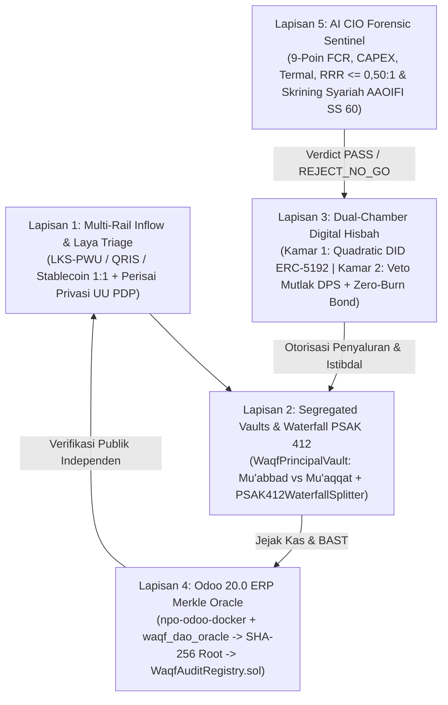

# WAQF DAO: Protokol Wakaf Produktif & Pasar Manakhah Digital Berbasis Aset Riil, PSAK 412, dan Digital Hisbah

**Klasifikasi Dokumen:** Kertas Putih Strategis Institusional (`ID`)  
**Versi:** `1.0.0` (Genesis Epoch `2026-11`)  
**Tanggal Publikasi:** 18 November 2026  
**Jangkar Kelembagaan:** Yayasan Amal Produktif Indonesia (`STBPN BWI 3.3.00386`) · PT Produktif Indonesia Berdaya (`PT PIB`) · Forum Wakaf Produktif (`FWP`) · Asosiasi Nazhir Indonesia (`ANI`)  
**Kerangka Kerja Tata Kelola & Dampak:** WAQF Framework (*Wijhah · 'Azam · Qiyam · Fahs*)  
**Standar Rujukan:** AAOIFI Shari'ah Standard No. 60 (*Waqf*) · AAOIFI Governance Standard No. 13 · PSAK 412 (eks-PSAK 112) · UU No. 41/2004 · POJK 27/2024 jo. POJK 23/2025 · UU No. 27/2022 (UU PDP)

---

## Ringkasan Eksekutif

Ekosistem perwakafan modern di Indonesia dan dunia Islam menghadapi dua tantangan struktural yang saling bertolak belakang. Di satu sisi, pengelolaan wakaf konvensional sering terjebak pada pembukuan manual yang terfragmentasi, lemahnya keterlacakan penyaluran manfaat (*mauquf 'alaih*), serta rendahnya likuiditas pembiayaan proyek produktif. Di sisi lain, gelombang awal proyek *Islamic Web3* justru kerap terjebak pada volatilitas emisi token spekulatif, terputus dari laporan keuangan syariah teraudit (**PSAK 412 / AAOIFI FAS 37**), serta berbenturan dengan regulasi pertanahan dan keuangan nasional.

**WAQF DAO** hadir menjembatani jurang tersebut dengan memadukan prinsip abadi fikih wakaf ***Tahbisul Ashli wa Tasbilul Manfa'ah*** (menahan pokok aset agar abadi dan mengalirkan manfaatnya untuk umat) ke dalam infrastruktur protokol terprogram yang terikat langsung pada pembukuan operasional nyata:

1. **Berakar pada Rekam Jejak Teraudit Nyata:** Lahir dari arsitektur produksi **Yayasan Amal Produktif Indonesia (`STBPN BWI 3.3.00386`)** dan entitas pengelola komersial **PT Produktif Indonesia Berdaya (`PT PIB`)**, dengan raihan **empat kali berturut-turut opini Wajar Tanpa Pengecualian (`KAP WTP` Tahun Buku `2022–2025`)** sesuai **PSAK 412**. Total aset kelolaan bertumbuh terukur dari **Rp1.011,60 juta (`2024`)**, menjadi **Rp1.114,36 juta (`2025`)**, dan proyeksi penuh **Rp1.404,88 juta (`2026`, Epoch `2026-11`)** dengan selisih rekonsiliasi nol (`reconciliation_diff_idr == 0`).
2. **Validasi Sektor Riil Berdampak Tinggi:** Terbukti melalui proyek unggulan **Nautera (Akuakultur Udang Vaname, Pool `WPUD`)** senilai **Rp832,4 juta** (skema berproteksi pokok **Ijarah Rp532,4 juta + Qardh Hasan Rp300 juta**) dengan imbal hasil kas bersih **18,02% p.a.**, *Risk-Reward Ratio* **0,42 : 1**, dan pembagian *waterfall* **`40%` Sinking Fund / `50,5%` Mauquf 'Alaih / `9,5%` Nazhir**; serta klaster **Infrastruktur Air Bersih (`WPAIR`)** dengan **SROI `1 : 4,11`** pada **41 klaster aktif** yang melayani **26.357 penerima manfaat**.
3. **Brankas Nir-Pemilik (*Dhimmah Maliyyah Mustaqillah*):** Mengkodifikasikan klausul **AAOIFI SS 60 `2/4/2`** dan **PSAK 412 paragraf 17** agar pokok wakaf (*Mu'abbad*) terkunci dalam *smart vault* nir-pemilik yang bebas dari penyalahgunaan admin maupun percampuran neraca yayasan, serta memisahkan **wakaf temporer (*Mu'aqqat*) sebagai liabilitas** (**PSAK 412 paragraf 23**).
4. **Tata Kelola *Digital Hisbah* Dua Kamar & Perisai AI CIO:** Memadukan pemungutan suara kuadratik berbasis *Soulbound DID* (`ERC-5192`, Kamar 1) dengan hak veto mutlak **Dewan Pengawas Syariah (`DPS`)** (Kamar 2), disaring terlebih dahulu oleh mesin **AI CIO Forensic Sentinel 9-Poin** yang menolak proyek berisiko asimetris atau rekayasa biologis sebelum dana wakaf disentuh.
5. **Kepatuhan Regulasi Terkini (`OJK POJK 23/2025`, `FGD DSN-MUI 18 November 2026`, `BWI`, `UU PDP`):** Dirancang agar bebas dari kategori instrumen derivatif kripto spekulatif, menjaga privasi identitas *wakif* melalui *salted SHA-256 Merkle commitments*, serta siap menjadi infrastruktur federasi bagi anggota **Forum Wakaf Produktif (`FWP`)** dan **Asosiasi Nazhir Indonesia (`ANI`)**.

---

## 1. Tesis Sejarah 1.400 Tahun: Neo-Pasar Madinah

Desain protokol **WAQF DAO** tidak bertumpu pada asumsi ekonomi spekulatif, melainkan menerjemahkan kembali arsitektur sosio-ekonomi yang dibangun Rasulullah ﷺ di Madinah Al-Munawwarah sebagai model **Neo-Pasar Madinah**:

1. **Jangkar Spiritual & Baitul Maal (*Masjid Quba & Masjid Nabawi*):** Pembangunan masjid sebagai pusat koordinasi umat, pendidikan, dan solidaritas sosial di mana kepemilikan aset inti terlepas dari penguasaan oligarki pribadi.
2. **Pasar Wakaf Publik (*Pasar Manakhah*):** Ketika perdagangan Madinah dikuasai oleh praktik monopoli dan pungutan sewa lahan yang mencekik pedagang kecil, Rasulullah ﷺ menetapkan kawasan **Pasar Al-Manakhah** sebagai ruang niaga publik yang diwakafkan untuk kemandirian ekonomi masyarakat.
3. **Prinsip *La Kharaja* (Pelindungan Modal dari Sewa Predatoris):** Di Pasar Manakhah ditegakkan kaidah *La Kharaja*—para pedagang kecil tidak boleh dibebani pungutan sewa tanah atau pajak eksploitatif yang menggerus modal kerja produktif mereka. Dalam konteks modern, prinsip ini menuntut struktur akad yang **melindungi pokok aset wakaf (`Hifzh al-Mal`)** serta melarang penumpukan *fee* perantara (*double-Nazhir stacking*) dan klausul pemindahan aset kembali ke operator di akhir kontrak (*capital trap*).
4. **Lembaga *Al-Hisbah* (Pengawasan Pasar Independen):** Untuk menjaga kejujuran takaran, kualitas barang, keadilan harga, dan integritas akad, negara menunjuk petugas *Muhtasib* yang melakukan pengawasan berkelanjutan. Dalam **WAQF DAO**, fungsi *Al-Hisbah* tersebut diwujudkan melalui **Dual-Chamber Digital Hisbah**, **Oracle Merkle Odoo 20.0 ERP**, dan **AI CIO Forensic Sentinel**.

### Integrasi ke dalam WAQF Framework (`Wijhah · 'Azam · Qiyam · Fahs`)

| Tahap WAQF Framework | Fondasi Historis Madinah | Implementasi Kelembagaan Yayasan API × PT PIB | Implementasi Protokol WAQF DAO |
| :--- | :--- | :--- | :--- |
| **1. *Wijhah*** *(Arah & Niat Strategis)* | Niat kemaslahatan *Masjid Nabawi* & sumur *Raumah* | Penetapan *Akta Ikrar Wakaf* (`AIW`/`APAIW`) dan taksonomi 5 *pool* wakaf | Klasifikasi deterministik `laya_triage_adapter` (`WPUD`, `WPUM`, `WPAIR`, `WPPAL`, `WPMAS`) |
| **2. *'Azam*** *(Kovenan & Pemagaran Akad)* | Piagam *Pasar Manakhah* & prinsip *La Kharaja* | Pemisahan Nazhir **Yayasan API (`STBPN 3.3.00386`)** × Operator **`PT PIB`**, akad *Ijarah + Qardh Hasan* | `WaqfPrincipalVault` (`2/4/2`), `PSAK412WaterfallSplitter` (`<= 10%` Nazhir), `WaqfIdentitySBT` |
| **3. *Qiyam*** *(Eksekusi Aset Produktif)* | Aktivitas niaga riil & pelayanan air bagi warga | Operasional tambak *Nautera* (`Rp832,4 jt`), `41` klaster air bersih `WPAIR`, Sukuk Negara `CWLS` | Pencairan bertahap berbasis kontrak *Ijarah* & validasi telemetri `BAST` lapangan |
| **4. *Fahs*** *(Audit, SROI & Hisbah)* | Inspeksi pasar oleh lembaga *Al-Hisbah* | **Odoo 20.0 ERP**, Laporan **PSAK 412** 5 komponen, opini **KAP WTP 2022–2025**, audit **SROI `1:4,11`** | Penjangkaran akar Merkle di `WaqfAuditRegistry.sol`, Veto **DPS** (`ShariahOracle`), & skrining **AI CIO** |

---

## 2. Kritik Lanskap Global: Pembelajaran dari Generasi Pertama Web3 Syariah

Analisis terhadap tiga inisiatif pelopor *Islamic Web3* menjelaskan mengapa **WAQF DAO** mengadopsi pendekatan *asset-backed* dan *ERP-anchored*:

- **Finterra (*Waqf Chain*):** Pelopor tokenisasi aset wakaf sejak 2019 ini terbentur pada **jebakan biaya hukum dan fragmentasi regulator** lintas yurisdiksi. Sertifikasi tanah wakaf bersifat sangat teritorial (seperti aturan BPN dan UU 41/2004 di Indonesia atau Majlis Agama Islam Negeri di Malaysia); memindahkan sertifikat tanah langsung ke *blockchain* tanpa jangkar *Nazhir* berizin dan bank kustodian syariah lokal menimbulkan biaya penstrukturan SPV yang tinggi dan resistensi otoritas domestik.
- **HAQQ Network (*Evergreen DAO / ISLM*):** Berhasil memperkenalkan *Shariah Oracle* di tingkat Layer-1 EVM/Cosmos dan mendanai *Evergreen DAO* secara otomatis dari emisi token. Namun, ketergantungan pada emisi token kripto asli (`ISLM`) menciptakan **risiko volatilitas harga** yang bertentangan dengan kaidah penjagaan daya beli pokok wakaf tunai (**AAOIFI SS 60 `2/4/13`**), serta **absennya tautan audit akuntansi fiat *off-chain*** (tidak ada rekonsiliasi neraca PSAK/FAS atau verifikasi fisik `BAST`).
- **Tawf Labs (*Tawf Foundation / Tawf ID*):** Memberikan preseden modular yang sangat berharga melalui *smart contract* `FeeRouter` komersial dan identitas *Soulbound* (`Tawf ID`) yang berakar pada semangat Baitul Maal wat Tamwil (`BMT`). **WAQF DAO** memperluas fondasi modular ini dengan menambahkan pemisahan pokok permanen (*Mu'abbad*) vs liabilitas wakaf temporer (*Mu'aqqat*), pembatasan *waterfall* berbasis undang-undang (`UU 41/2004`), oracle ERP **Odoo 20.0**, serta penyaringan forensik biologis-finansial berbasis AI.

---

## 3. Arsitektur Produksi Yayasan API (`STBPN 3.3.00386`) × PT PIB & Studi Kasus Lapangan

Berbeda dengan kertas putih konseptual semata, seluruh parameter **WAQF DAO** dikalibrasi dari data akuntansi dan proyek riil yang telah diaudit secara independen:

### 3.1 Pemisahan Entitas Pelaporan (`PSAK 412 Paragraf 17`)
Berdasarkan **PSAK 412 paragraf 17**, aset wakaf merupakan entitas pelaporan tersendiri yang **tidak boleh dikonsolidasikan** ke dalam neraca badan hukum pengelolanya. Dalam arsitektur produksi kami:
- **Entitas Nazhir Terdaftar:** **Yayasan Amal Produktif Indonesia (`STBPN BWI 3.3.00386`)** bertindak sebagai pemegang amanah wakaf, penerbit pelaporan **PSAK 412** lima komponen, dan peraih opini audit eksternal **KAP Wajar Tanpa Pengecualian (`WTP`) empat tahun berturut-turut (`FY 2022–2025`)**.
- **Entitas Operator Sektor Riil (`SPV`):** **PT Produktif Indonesia Berdaya (`PT PIB`)** bertindak sebagai mitra pelaksana operasional komersial di lapangan melalui kontrak komersial *arm's-length*, memisahkan risiko operasional bisnis harian dari kekebalan hukum aset wakaf.
- **Perkembangan Neraca Wakaf Teraudit (`PSAK 412`):**

| Tahun Buku | Status Audit / Proyeksi | Total Aset Wakaf | Liabilitas Wakaf Temporer (*Mu'aqqat*) | Aset Neto Wakaf (*Mu'abbad*) | Selisih Rekonsiliasi |
| :---: | :--- | :---: | :---: | :---: | :---: |
| **FY 2024** | Teraudit **KAP (`WTP`)** | `Rp 1.011.600.000` | `Rp 25.000.000` | `Rp 986.600.000` | `Rp 0` |
| **FY 2025** | Teraudit **KAP (`WTP`)** | `Rp 1.114.360.000` | `Rp 50.000.000` | `Rp 1.064.360.000` | `Rp 0` |
| **FY 2026** | Proyeksi Penuh (**Epoch `2026-11`**) | `Rp 1.404.880.000` | `Rp 63.000.000` | `Rp 1.341.880.000` | `Rp 0` |

### 3.2 Studi Kasus Utama: *Nautera* (`Pool WPUD` — Total Fasilitas `Rp832,4 Juta`)
Untuk mematahkan skema investasi agribisnis berisiko tinggi yang kerap merugikan wakaf (seperti skema *Mudharabah* tanpa agunan di mana seluruh kerugian panen ditanggung oleh pokok wakaf), proyek akuakultur udang vaname pesisir **Nautera** dirancang menggunakan struktur hibrida berproteksi pokok penuh:

1. **Komposisi Pendanaan `Rp832,4 Juta`:**
   - **Ijarah Aset Produktif (`Rp532.400.000`):** Entitas wakaf membeli dan memiliki langsung aset riil produktif (kolam HDPE pesisir, kincir aerasi, genset, instalasi kelistrikan), lalu menyewakannya kepada operator dengan arus kas sewa terukur. Pokok aset tetap berada dalam kendali hukum Nazhir hingga akhir periode—menutup celah *capital trap* pengalihan aset ke operator.
   - **Qardh Hasan Modal Kerja (`Rp300.000.000`):** Fasilitas modal kerja tanpa riba yang dijamin agunan komersial jangka panjang dan kontrak pembeli (*off-taker*) rantai dingin B2B terverifikasi.
2. **Kinerja & *Waterfall* Pembagian Hasil Kas (`Cash Basis`, PSAK 412 Par. 36):**
   - **Imbal Hasil Kas Bersih ke Yayasan:** **18,02% p.a.** (berbanding lantai *risk-free* Sukuk Wakaf Negara **CWLS `6,00%–6,75%`**).
   - ***Risk-Reward Ratio (`RRR`):** `0,42 : 1` (jauh di bawah batas maksimum komite investasi `0,50 : 1`).
   - **Rasio Penilaian *Istibdal*:** `108,4%` (melampaui batas minimal `102%` penilaian independen KJPP).
   - **Alokasi *Waterfall* Nautera:**
     - **40,0% — *Sinking Fund* (`SF`):** Cadangan depresiasi, pemeliharaan kolam, dan bantalan biosekuriti mortalitas.
     - **50,5% — *Mauquf 'Alaih*:** Penyaluran langsung kepada penerima manfaat (pemberdayaan pekerja tambak pesisir & beasiswa) dengan gerbang *BAST*.
     - **9,5% — Imbalan (*Ujrah*) Nazhir:** Secara matematis patuh berada di bawah batas maksimal **10% UU No. 41/2004 Pasal 12 & Pasal 67 ayat (3)**.
3. **Validasi AI CIO Sentinel vs Proposal Bioflok Bermasalah:**
   Pada saat yang sama, mesin `ai-cio-sentinel` berhasil menolak proposal bioflok dataran tinggi yang mengajukan klaim **FCR `0,56`** (mustahil secara termodinamika karena `1 kg` pakan tidak mungkin menjadi `1,78 kg` biomassa), mark-up CAPEX **+83,6%**, lokasi dingin `< 21°C` tanpa pemanas, akad *Mudharabah* cacat, dan **RRR `6,83 : 1`** (**Skor Risiko `92/100` — `REJECT_NO_GO`**), sedangkan **Nautera** memperoleh status **`PASS` (Skor Risiko `14/100`)**.

### 3.3 Studi Kasus Infrastruktur Sosial: *WPAIR* Air Bersih (`SROI 1 : 4,11`)
Pada pilar infrastruktur dasar (**Pool `WPAIR`**), implementasi sumur bor komunal, filtrasi gravitasi, dan pompa tenaga surya telah membuktikan dampak sosial terukur:
- **Social Return on Investment (`SROI`):** **`1 : 4,11`** (setiap `Rp1` wakaf menghasilkan nilai manfaat sosial kesehatan, penghematan waktu pengambilan air, dan sanitasi sebesar `Rp4,11`).
- **Skala Operasional Aktif:** **`41` klaster aktif** yang menjangkau **`26.357` penerima manfaat terverifikasi**.
- **Struktur *Waterfall* Klaster (`BAST-WPAIR`):** `20,0%` *Sinking Fund* pemeliharaan O&M komunal / `70,0%` *Mauquf 'Alaih* / `10,0%` imbalan Nazhir.

### 3.4 Ringkasan Lima *Pool* Wakaf Genesis (`Epoch 2026-11`)

| Kode Pool | Fokus Sektor Riil | Alokasi Epoch `2026-11` (`Rp`) | Model Akad Pelindung Pokok | SROI | Imbal Hasil / Dampak |
| :---: | :--- | :---: | :--- | :---: | :--- |
| **`WPUD`** | Akuakultur Vaname RWA (*Nautera*) | `Rp 450.000.000` *(total proyek `Rp832,4 Jt`)* | Hibrida *Ijarah* + *Qardh Hasan* | `3,85x` | **18,02% p.a.** bersih (`RRR 0,42:1`) |
| **`WPUM`** | Wakaf Produktif Multisektor & CWLS | `Rp 310.000.000` | Sukuk Negara **CWLS** + UMKM Terjamin | `5,04x` | **6,75% p.a.** lantai bebas risiko negara |
| **`WPAIR`** | Infrastruktur Air Bersih Komunal | `Rp 284.880.000` | *Istisna'* + Cadangan O&M Komunal | **`4,11x`** | **`41` klaster · `26.357` penerima manfaat** |
| **`WPPAL`** | Dana Abadi Kemanusiaan & Pangan | `Rp 210.000.000` | Pokok Terpagar Abadi (*Mu'abbad*) | `4,25x` | `7,20% p.a.` nutrisi darurat & yatim |
| **`WPMAS`** | Masjid, Madrasah & Surya Mikrogrid | `Rp 150.000.000` | *Ijarah* Atap Surya + Kafalah Guru Ngaji | `3,90x` | `8,10% p.a.` penghematan kWh ke guru |

---

## 4. Arsitektur 5 Lapisan Protokol WAQF DAO

1. **Lapisan 1 — *Multi-Rail Inflow*, *Laya System-1 Triage*, & Perisai Privasi UU PDP:**
   Dana masuk dari jalur perbankan **LKS-PWU** (rupiah) atau jalur aset digital 1:1 terregulasi diklasifikasikan otomatis oleh `laya_triage_adapter.py` ke dalam lima *pool* (`WPUD`, `WPUM`, `WPAIR`, `WPPAL`, `WPMAS`) dengan proteksi isolasi entitas (`Zero-Spill`). Identitas *wakif* (NIK, telepon, email) tidak pernah disimpan atau diunggah ke *blockchain*; `privacy_shield.py` menggantinya dengan komitmen kriptografis bercampur garam (*salted SHA-256*) `waqf:uupdp:v1:{salt}:{id}` demi kepatuhan **UU No. 27 Tahun 2022 tentang Pelindungan Data Pribadi (`UU PDP`)**.
2. **Lapisan 2 — Brankas Terpisah & *Waterfall* Statutori (`WaqfPrincipalVault.sol` & `PSAK412WaterfallSplitter.sol`):**
   Memisahkan secara keras antara aset neto permanen (*Mu'abbad*) dan liabilitas wakaf berjangka (*Mu'aqqat*), serta memastikan di level *bytecode* bahwa **imbalan Nazhir tidak dapat melampaui 10% (`1.000 bps`)**, alokasi ***Mauquf 'Alaih* minimal 50% (`5.000 bps`)**, dan ***Sinking Fund* minimal 10% (`1.000 bps`)** hanya dari kas neto yang benar-benar telah direalisasikan.
3. **Lapisan 3 — Tata Kelola *Digital Hisbah* Dua Kamar (`DigitalHisbahGovernor.sol` & `ShariahOracle.sol`):**
   Mencegah pembajakan tata kelola oleh pemilik modal besar (*whale*) melalui token identitas non-transferable **ERC-5192 (`WaqfIdentitySBT`)** dan pembobotan suara kuadratik di **Kamar 1**, sementara **Kamar 2 (Dewan Pengawas Syariah / `DPS`)** memegang hak veto mutlak sesuai **AAOIFI GS 13**. Jika proposal melanggar syariah atau gagal uji forensik, dana jaminan proposal tidak dibakar (*Zero-Burn*), melainkan **dialihkan permanen ke pokok *Mu'abbad***.
4. **Lapisan 4 — Oracle Merkle Odoo 20.0 ERP (`npo-odoo-docker` + `waqf_dao_oracle`):**
   Modul `waqf_dao_oracle` di dalam **Odoo 20.0** menyusun snapshot 5 komponen **PSAK 412**, memvalidasi persamaan neraca (`total_assets == temp_liabilities + net_assets`, `reconciliation_diff == 0`), membangun pohon Merkle SHA-256 deterministik, dan menjangkarkannya ke jaringan EVM Layer-2 (`WaqfAuditRegistry.sol`). Pada **Genesis Epoch `2026-11`**, `10` dokumen kanonik terverifikasi pada akar Merkle `0x8847ae1a98d62b44dbbfe44900cce0620b7e13914d9bd509d3d694f8fb3921cc`.
5. **Lapisan 5 — AI CIO Forensic Sentinel (`packages/ai-cio-sentinel`):**
   Mesin uji tuntas deterministik 9-poin yang memverifikasi hukum fisika biologis (`FCR`), integritas pembukuan historis, kewajaran harga satuan `CAPEX`, rezim suhu & ketinggian lahan, kepadatan biomassa tangki sirkular (dengan *freeboard* `0,20 m` dan batas `50 kg/m³`), imbal hasil pasca-depresiasi, batas asimetri **`RRR <= 0,50:1`**, serta perbandingan *opportunity cost* terhadap **CWLS (`6,0%`)** dan **Nautera (`18,02%`)**.

---

## 5. Kesiapan Kepatuhan Hukum & Fatwa (`POJK 23/2025`, `DSN-MUI Sil'ah`, `BWI`)

Desain dualitas domestik-global WAQF DAO memastikan keselarasan penuh dengan rezim regulasi Indonesia terkini per November 2026:

1. **POJK No. 27 Tahun 2024 jo. POJK No. 23 Tahun 2025 (Aset Keuangan Digital / AKD OJK):**
   Dengan beralihnya pengawasan aset kripto ke OJK dan berlakunya **POJK 23/2025** (yang memperketat pengawasan produk menyerupai efek termasuk derivatif kripto), WAQF DAO **secara sadar tidak menerbitkan koin tata kelola yang dapat diperdagangkan atau derivatif kripto apa pun**. Identitas tata kelola berbentuk **SBT non-transferable (`ERC-5192`)**, sedangkan pencatatan audit bersifat bukti kriptografis *non-monetary* atas kas yang tetap berada di **LKS-PWU** berizin.
2. **FGD DSN-MUI 18 November 2026 tentang RWA & *Sil'ah*:**
   Untuk instrumen *Real-World Asset (`RWA`)* di masa depan, WAQF DAO mengadopsi konstruksi fikih ***sil'ah*** (aset/komoditas riil yang teridentifikasi jelas secara fisik, bernilai manfaat ekonomi nyata, sah kepemilikannya oleh Nazhir melalui *AIW/SHW/Ijarah*, dinilai oleh penilai independen `KJPP`, dan terbebas dari *gharar* serta transaksi semu).
3. **POJK No. 57/POJK.04/2020 (*Securities Crowdfunding / SCF*) & UU No. 41/2004:**
   Setiap penawaran sukuk produktif kepada pemodal ritel di masa depan dijalankan secara terpisah melalui Penyelenggara SCF berizin OJK, sementara pengelolaan wakaf uang tetap tunduk pada **LKS-PWU**, pelaporan **BWI**, dan batas pidana **Pasal 67 UU No. 41/2004**.

---

## 6. Peta Jalan 4 Fase *Marhaliyah* & Ajakan Federasi Nasional

Penerapan protokol berjalan secara bertahap (*Marhaliyah*) agar setiap fase teruji sebelum eskalasi nilai kelolaan:

- **Fase I (*Ta'sis & Jangkar Genesis* — Q4 2026):** Aktivasi penuh kontrak pintar Foundry, oracle Merkle **Odoo 20.0** di *testnet* Layer-2 (Base Sepolia), serta skrining AI CIO 9-poin pada seluruh proposal masuk di **Yayasan Amal Produktif Indonesia (`STBPN 3.3.00386`)**.
- **Fase II (*Wrapper Dual-Nexus & Federasi Nazhir Nasional* — H1 2027):** Pendirian payung hukum internasional (**RAK DAO DARe CLG** / **ADGM DLT Foundation**) dan pembukaan *node* federasi bagi lembaga anggota **Forum Wakaf Produktif (`FWP`)** serta **Asosiasi Nazhir Indonesia (`ANI`)** melalui paket siap pakai `npo-odoo-docker` + `waqf_dao_oracle`.
- **Fase III (*Integrasi API LKS-PWU & RWA Sil'ah Terregulasi* — H2 2027–2028):** Penyelarasan formal fatwa **DSN-MUI (*sil'ah*)** dan koridor **OJK POJK 23/2025 / POJK 57/2020** untuk penyelesaian arus kas *Ijarah* dan kupon *CWLS* secara otomatis.
- **Fase IV (*Jaringan Wakaf Produktif Lintas Negara OIC* — 2028+):** Interoperabilitas pelaporan **PSAK 412 / AAOIFI FAS 37** antara Nazhir Indonesia, Majlis Wakaf Malaysia, dan lembaga wakaf kawasan Teluk (`GCC`) dalam satu dasbor transparansi *Hisbah* global.

---

## Penutup

Melalui sinergi antara warisan hukum Islam 1.400 tahun (**Pasar Manakhah**, ***La Kharaja***, dan ***Al-Hisbah***), kedisiplinan akuntansi **PSAK 412** yang telah teruji empat opini **KAP WTP**, serta otomatisasi kode yang terikat pada **Odoo 20.0** dan **AI CIO Sentinel**, **WAQF DAO** mengembalikan marwah wakaf sebagai instrumen peradaban yang abadi pokoknya, terukur dampaknya (`SROI 1 : 4,11`), dan tak tergoyahkan integritasnya.
